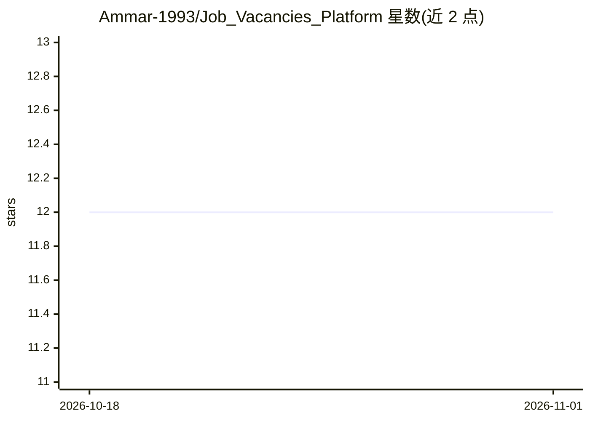

# Ammar-1993/Job_Vacancies_Platform

⭐ 12 · Blade · 推送 2026-09-20 · [GitHub](https://github.com/Ammar-1993/Job_Vacancies_Platform) · [官网](https://hireme-platform.online) · 个人维护

**AI 辅助招聘平台：职位匹配、简历分析与兼容度评分**

Laravel 12 单仓库招聘平台，包含面向候选人的 job-app、面向雇主与管理员的 job-backoffice，以及共享领域包 job-shared。核心功能覆盖职位发布与检索、PDF 简历上传、申请流转、RBAC/OBAC 权限控制。AI 部分通过 OpenAI API 在 Laravel 队列中异步完成简历解析、兼容度评分与改进建议，简历存于 S3 兼容私有存储。运行需 PHP 8.2+、MySQL/MariaDB、pdftotext 与 OpenAI API key；README 提示 AI 评分仅为决策辅助。

## 筛选速览

| 维度 | 判定 | 备注 |
|---|---|---|
| AI 角色 | `ai-enhanced` | 去掉 AI 部分产品仍成立 |
| 许可风险 | `none` | — |
| 部署形态 | `None` |  |
| 模型依赖 | — | README 未给出锁定关系 |
| 硬件要求 | — | 无带数字的原话,不猜 |
| 安装摩擦 | `low` | 无编译、无系统依赖或容器化 |
| 成熟度 | — | 结构信号不足 |

## 能力要点

- OpenAI API 生成简历兼容度评分与改进建议，经队列异步执行
- 模块化 monorepo：双 Laravel 应用 + 共享 Composer 领域包
- RBAC/OBAC 权限控制与简历私有对象存储
- Spatie PDF-to-Text + pdftotext 提取简历文本

## 适用场景

- 搭建带 AI 简历评估的招聘与求职平台
- 雇主按兼容度评分对申请者排序与筛选
- 统一管理公司、职位、申请与用户权限

## 场景标签

 · 领域:人力资源/招聘科技

## 证据(README 行号)

> L14: **Job Vacancies Platform** is a next-generation recruitment ecosystem designed to improve the way talent and employ
> L30: - Receive an AI-generated compatibility score and improvement recommendations.
> L107: |`ResumeAnalysisService`|Extracts PDF text, requests structured resume data, evaluates job fit, retries selected O

## 星数曲线

2026-10-18 12 → 2026-11-01 12（+0）

---
*卡片 v1 · prompt 1.4 · 生成 2026-11-01 · 置信度 high · 依据 README sha `cb1050762ffb` · [字段定义](../../DATASET.md)*
