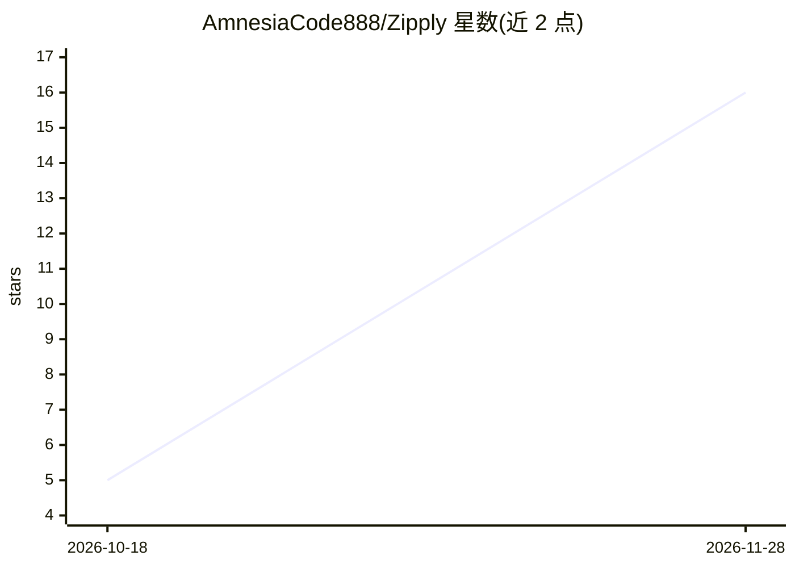

# AmnesiaCode888/Zipply

⭐ 16 · TypeScript · NOASSERTION · 推送 2026-11-26 · [GitHub](https://github.com/AmnesiaCode888/Zipply) · [官网](https://t.me/zipplyai) · 个人维护

**桌面 AI 编码工作区：多子代理协作完成代码编辑与验证**

基于 Electron + React + TypeScript 的桌面 AI 编码工作区。主代理（ZipplyAgent）与 Explorer/Reviewer/Worker 子代理通过共享 Blackboard 协调，提供文件读写、补丁、命令执行、代码智能分析、Playwright 浏览器验证等工具；支持只读/确认/自动/无限制四档自主权限控制，MCP 客户端（stdio/http）与 SKILL.md 动态技能扩展，内置安全扫描、SQLite、PDF 插件。提供 Windows/Linux 安装包，源码构建需 Node.js ≥18。当前版本 v0.1.0，采用 BSL 1.1 许可。

## 筛选速览

| 维度 | 判定 | 备注 |
|---|---|---|
| AI 角色 | `ai-native` | 本体是模型或模型工具 |
| 许可风险 | `none` | NOASSERTION |
| 部署形态 | `desktop` | 安装包/桌面程序 |
| 模型依赖 | — | README 未给出锁定关系 |
| 硬件要求 | — | 无带数字的原话,不猜 |
| 安装摩擦 | `low` | 无编译、无系统依赖或容器化 |
| 成熟度 | `idea` | |

## 能力要点

- 主代理 + Explorer/Reviewer/Worker 子代理的 Blackboard 协调架构
- 四档自主权限（只读/确认/自动/无限制）与高风险命令确认
- MCP 客户端支持 stdio/http，按工具信任审批
- 内置 CyberSec/SQLite/PDF 插件与 SKILL.md 动态技能

## 适用场景

- 在桌面工作区让 AI 代理自主完成代码修改与验证
- 需要细粒度权限控制的安全编码自动化
- 通过 MCP 与动态技能扩展代理能力

## 场景标签

`编码 Agent` `多智能体` · 领域:Agent 开发

## 证据(README 行号)

> L7:  **Autonomous Desktop AI Coding Workspace**
> L16:  Desktop AI coding partner with autonomous subagent orchestration, granular execution safety,
> L29: Zipply pairs a primary coding agent (`ZipplyAgent`) with specialized subagents coordinated via a shared `Blackboard

## 星数曲线

2026-10-18 5 → 2026-11-28 16（+11）

---
*卡片 v1 · prompt 1.4 · 生成 2026-11-28 · 置信度 high · 依据 README sha `4ce25db364a7` · [字段定义](../../DATASET.md)*
