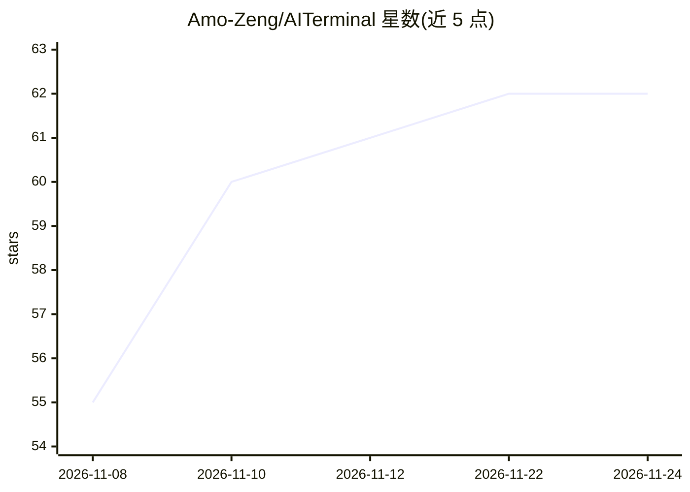

# Amo-Zeng/AITerminal

⭐ 62 · JavaScript · Apache-2.0 · 推送 2026-11-10 · [GitHub](https://github.com/Amo-Zeng/AITerminal) · 个人维护 · 中文 README

**带 AI 接管与插件中心的跨平台运维终端**

基于 Electron、xterm.js 和 SSH2 的开源桌面终端，将本地 PTY、SSH 连接、AI 问答、自然语言转命令、交互式命令接管与插件中心放在同一工作区。AI 可读取终端文本屏幕并向同一通道输入以执行多步任务，高危命令前需确认；支持 Chat Completions/Responses/Messages 三种 API 格式，模型 Key 由用户自备。插件中心支持参数化工具、MCP 集成、面板与开发 SDK。Windows/Linux/macOS 提供安装包，Windows 本地终端依赖 WSL。

## 筛选速览

| 维度 | 判定 | 备注 |
|---|---|---|
| AI 角色 | `ai-enhanced` | 去掉 AI 部分产品仍成立 |
| 许可风险 | `permissive` | Apache-2.0 |
| 部署形态 | `desktop` | 安装包/桌面程序 |
| 模型依赖 | — | README 未给出锁定关系 |
| 硬件要求 | — | 无带数字的原话,不猜 |
| 安装摩擦 | `low` | 无编译、无系统依赖或容器化 |
| 成熟度 | — | 结构信号不足 |

## 能力要点

- AI 读取当前终端文本屏幕并向同一通道输入执行多步任务
- 支持 Chat Completions、Responses、Messages 三种 API 格式
- 插件中心：参数化工具、MCP 集成、面板与插件开发 SDK
- SSH 主机指纹核验、凭据系统加密存储、Webhook 任务通知

## 适用场景

- SSH 到多层跳板机后让 AI 接着处理终端任务
- 长时运行的 CLI 任务结束后通过 Webhook 收到通知
- 把团队反复执行的巡检排障流程做成插件复用
- 自然语言描述需求生成命令，检查后按需执行

## 场景标签

`GUI 自动化` `AI 助手` · 领域:效率与自动化

## 证据(README 行号)

> L12: AITerminal 是基于 Electron、xterm.js 和 SSH2 的开源桌面终端，将本地 PTY、SSH、AI 对话、交互式命令接管和插件中心放在同一工作界面。源码使用 **Apache License 2.0**，
> L71: - **AI 问答与命令助手**：自然语言问答、`fix` 错误诊断、`analyze` 系统分析、`cmd` 自然语言转命令；支持流式回复、分屏、Markdown、代码高亮、数学公式和自定义回答要求。

## 星数曲线

2026-11-08 55 → 2026-11-24 62（+7）

---
*卡片 v1 · prompt 1.4 · 生成 2026-11-18 · 置信度 high · 依据 README sha `254362aeeb94` · [字段定义](../../DATASET.md)*
