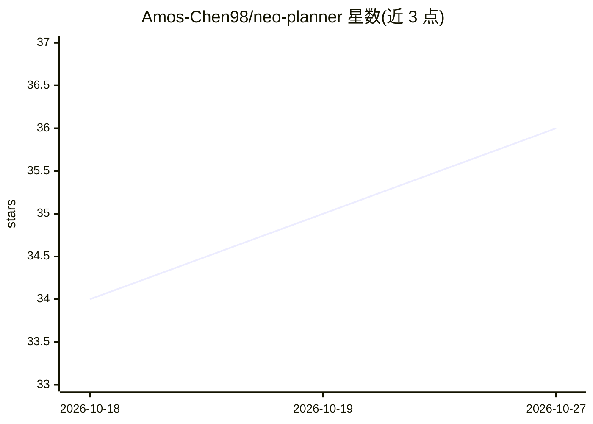

# Amos-Chen98/neo-planner

⭐ 36 · Python · GPL-3.0 · 推送 2026-01-08 · [GitHub](https://github.com/Amos-Chen98/neo-planner) · [官网](https://yichengchen.com/publication/neo-planner) · 组织维护

**IROS'25 无人机导航规划器：学习初始化轨迹优化**

IROS'25 论文 Learning to Initialize Trajectory Optimization 的官方代码库，提供基于 ROS 与 PX4 SITL 的无人机视觉自主导航开发环境。核心是用学习到的网络为轨迹优化提供初始值，实现未知环境中的自主飞行；另含目标跟踪避障扩展应用。支持批量生成 Gazebo 世界、生成真值点云与 octomap、用专家规划器采集数据并训练自定义网络。限定 Ubuntu 20.04 + ROS Noetic，依赖 PX4、MAVROS、QGroundControl 与 GPU 版 PyTorch。

## 筛选速览

| 维度 | 判定 | 备注 |
|---|---|---|
| AI 角色 | `ai-native` | 本体是模型或模型工具 |
| 许可风险 | `viral` | GPL-3.0 |
| 部署形态 | `library` | 以包/库形式分发 |
| 模型依赖 | — | README 未给出锁定关系 |
| 硬件要求 | — | 无带数字的原话,不猜 |
| 安装摩擦 | `low` | 无编译、无系统依赖或容器化 |
| 成熟度 | — | 结构信号不足 |

## 能力要点

- 学习网络为轨迹优化提供初始值，实现视觉自主飞行
- ROS + PX4 SITL 仿真开发环境，含自主导航与目标跟踪避障
- 批量生成 Gazebo 世界并导出真值点云/octomap
- 专家规划器采集数据，可训练自定义网络

## 适用场景

- 复现论文中的无人机自主导航与轨迹规划实验
- 在 Gazebo 仿真中做无人机导航算法的定制开发
- 采集专家数据训练自己的轨迹初始化网络

## 场景标签

 · 领域:机器人/无人机导航

## 证据(README 行号)

> L5: This is the code repository for the IROS'25 paper:
> L7: **Learning to Initialize Trajectory Optimization for Vision-Based Autonomous Flight in Unknown Environments**
> L21: This repository (as a ROS workspace) provides a developing environment for drone navigation based on ROS and PX4 so
> L149: #### 3.2.3 Collect data and train your own network

## 星数曲线

2026-10-18 34 → 2026-10-27 36（+2）

---
*卡片 v1 · prompt 1.4 · 生成 2026-10-25 · 置信度 mid · 依据 README sha `bbdce049f84b` · [字段定义](../../DATASET.md)*
