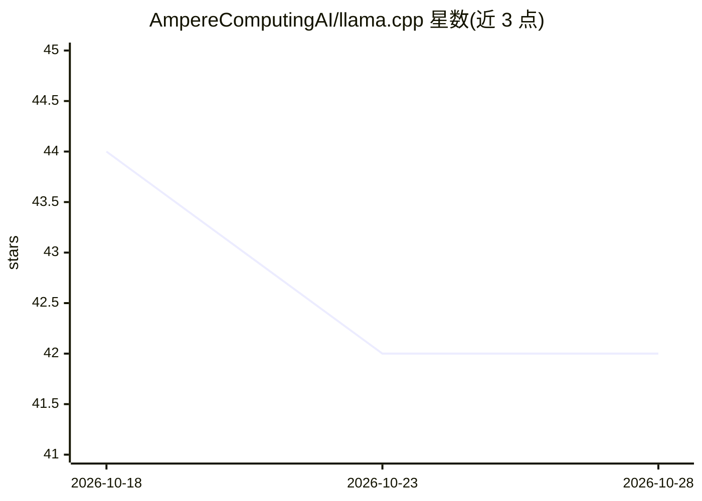

# AmpereComputingAI/llama.cpp

⭐ 42 · Python · 推送 2026-06-24 · [GitHub](https://github.com/AmpereComputingAI/llama.cpp) · [官网](https://hub.docker.com/r/amperecomputingai/llama.cpp) · 组织维护

**面向 Ampere CPU 优化的 llama.cpp 构建与 Docker 镜像**

AmpereComputing 维护的 llama.cpp 优化构建，以 Docker 镜像形式发布，默认入口运行 llama.cpp server，可在 Ampere CPU 裸机与云端 Ampere VM 上运行。新增 Q4_K_4 与 Q8R16 两种量化格式，提供 HF 转 GGUF 脚本与 llama-quantize 量化流程，支持 HuggingFace 上的 GGUF 模型。README 附有按机型与软件分类的基准数据，发布说明与二进制在 GitHub。

## 筛选速览

| 维度 | 判定 | 备注 |
|---|---|---|
| AI 角色 | `ai-ecosystem` | LLM/agent 周边工具 |
| 许可风险 | `none` | — |
| 部署形态 | `self-host` | docker 或自建部署 |
| 模型依赖 | — | README 未给出锁定关系 |
| 硬件要求 | — | 无带数字的原话,不猜 |
| 安装摩擦 | `low` | 无编译、无系统依赖或容器化 |
| 成熟度 | — | 结构信号不足 |

## 能力要点

- 新增 Q4_K_4 与 Q8R16 两种量化方法
- Docker 镜像默认运行 llama.cpp server，可换 shell 入口
- 提供 convert-hf-to-gguf.py 转换与 llama-quantize 量化流程
- 附按机型与软件分类的基准结果

## 适用场景

- 在 Ampere CPU 服务器或云 VM 上部署 GGUF 模型推理服务
- 将 HuggingFace 模型转为 GGUF 并用 Ampere 定制量化格式压缩
- 查阅 Ampere 平台上的 llama.cpp 推理基准数据

## 场景标签

`推理引擎` `模型量化` · 领域:训练与推理

## 证据(README 行号)

> L2: # Ampere® optimized llama.cpp
> L14: Default entrypoint runs the server binary of llama.cpp, mimicking behavior of original llama.cpp server image: dock

## 星数曲线

2026-10-18 44 → 2026-10-28 42（-2）

---
*卡片 v1 · prompt 1.4 · 生成 2026-10-25 · 置信度 high · 依据 README sha `cf592a481e58` · [字段定义](../../DATASET.md)*
