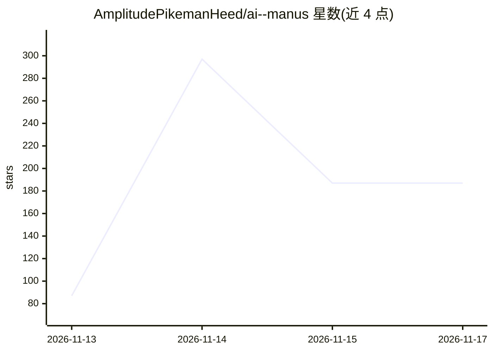

# AmplitudePikemanHeed/ai--manus

⭐ 187 · Apache-2.0 · 推送 2026-11-15 · [GitHub](https://github.com/AmplitudePikemanHeed/ai--manus) · 个人维护

**面向个人用户的自主 AI Agent：代跑代码与控制浏览器**

README 描述的通用自主 AI Agent 系统：代替用户编写并执行脚本、控制浏览器（导航网页、填写表单、收集信息）、执行多步骤任务，定位为家庭、学习与轻量办公场景的后台个人助手，需最少监督。页面顶部提供下载入口（附 PROMO2026 字样）。README 给出硬件兼容表（建议 8GB 内存、多核 CPU）与上手步骤，但未给出任何具体安装命令、运行方式或源码说明，技术实现细节不可验证。

## 筛选速览

| 维度 | 判定 | 备注 |
|---|---|---|
| AI 角色 | `ai-native` | 本体是模型或模型工具 |
| 许可风险 | `permissive` | Apache-2.0 |
| 部署形态 | `None` |  |
| 模型依赖 | — | README 未给出锁定关系 |
| 硬件要求 | — | 无带数字的原话,不猜 |
| 安装摩擦 | `low` | 无编译、无系统依赖或容器化 |
| 成熟度 | — | 结构信号不足 |

## 能力要点

- 自主执行代码与控制浏览器完成多步骤任务
- 同一工作流内衔接脚本与浏览器操作
- 定位个人/学习/轻量办公场景，无需开发背景

## 适用场景

- 让 Agent 代为填写表单、抓取多页面信息
- 整理研究笔记、跑小脚本等日常杂务
- 后台委托重复性小任务

## 场景标签

`浏览器自动化` `AI 助手` · 领域:效率与自动化

## 证据(README 行号)

> L10: - **Autonomous Code Execution:** Manus AI agent runs code on its own to complete tasks, so you can focus on decisio
> L18: Manus is an autonomous AI agent designed to run code and control a browser on your behalf. Instead of acting like a

## 星数曲线

2026-11-13 87 → 2026-11-17 187（+100）

---
*卡片 v1 · prompt 1.4 · 生成 2026-11-17 · 置信度 low · 依据 README sha `0f78ee3a5dd2` · [字段定义](../../DATASET.md)*
