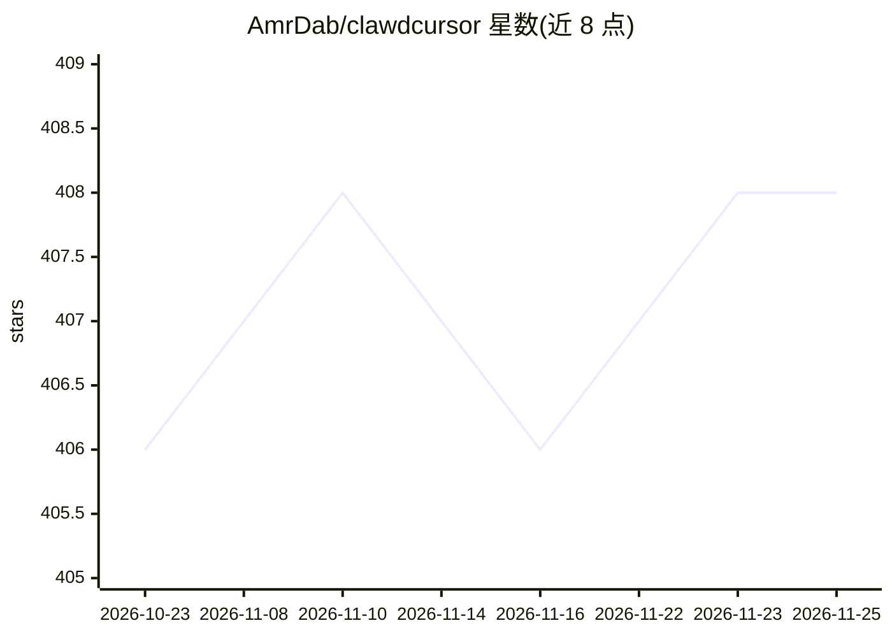

# AmrDab/clawdcursor

⭐ 408 · TypeScript · MIT · 推送 2026-11-23 · [GitHub](https://github.com/AmrDab/clawdcursor) · [官网](https://clawdcursor.com) · 个人维护

**MCP 桌面控制服务器：让 AI agent 以元素名操作 Windows/macOS/Linux GUI**

开源 MIT 的本地 MCP 服务器，向任意 MCP 客户端（Claude、Codex、Cursor、本地模型等）提供 accessibility、system、window、browser、computer、batch 六个工具，用于操作真实桌面。按页面对象、无障碍树、OCR、截图的顺序读取屏幕，按元素名执行动作，并在每次动作后回报 confirmed/unverified/refused/failed 状态。自身不含模型、不需要 API key；提供 Stop 按钮、暂停/恢复、密码字段不读取、禁止锁屏按键、本地 127.0.0.1+token 等保护，无内置策略引擎。

## 筛选速览

| 维度 | 判定 | 备注 |
|---|---|---|
| AI 角色 | `ai-ecosystem` | LLM/agent 周边工具 |
| 许可风险 | `permissive` | MIT |
| 部署形态 | `library` | 以包/库形式分发 |
| 模型依赖 | — | README 未给出锁定关系 |
| 硬件要求 | — | 无带数字的原话,不猜 |
| 安装摩擦 | `low` | 无编译、无系统依赖或容器化 |
| 成熟度 | — | 结构信号不足 |

## 能力要点

- 六工具 MCP 接口，读取优先级为页面→无障碍树→OCR→截图
- 每次动作后回报 confirmed/unverified/refused/failed，支持 expect 校验
- Stop 按钮、屏幕状态提示、用户中途接管时等待等安全机制
- npm 安装，跨平台（Linux 支持但未做基准测试）

## 适用场景

- 让 AI agent 完成只能通过 GUI 操作的应用任务
- 自动化包含登录、2FA 等需人工步骤的工作流
- 为使用 AI 的桌面自动化流程添加动作核验与安全防护

## 场景标签

`GUI 自动化` · 领域:效率与自动化

## 证据(README 行号)

> L26: Clawd Cursor is a free, open-source (MIT) MCP server. Your AI (Claude, Codex, Cursor, a local model, any MCP client
> L32: Clawd Cursor has no model and no API key of its own: your AI makes every decision. Use it for the steps that only e

## 星数曲线

2026-10-23 406 → 2026-11-25 408（+2）

---
*卡片 v1 · prompt 1.4 · 生成 2026-11-25 · 置信度 high · 依据 README sha `250f5040bf7b` · [字段定义](../../DATASET.md)*
