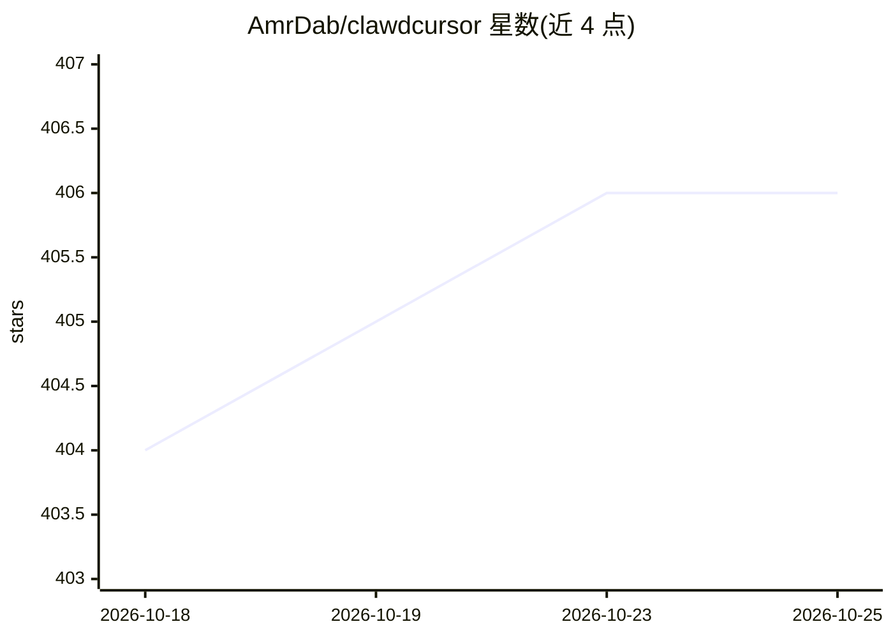

# AmrDab/clawdcursor

⭐ 406 · TypeScript · MIT · 推送 2026-10-25 · [GitHub](https://github.com/AmrDab/clawdcursor) · [官网](https://clawdcursor.com) · 个人维护

**本地 MCP 服务器：让任意 AI agent 安全控制桌面 GUI**

面向工具调用型 agent（Claude Code、Cursor、Windsurf 等）的本地 MCP 服务器，提供跨 Windows/macOS/Linux 的桌面控制能力。感知层将无障碍树与 OCR 融合为带稳定 el_NN id 的 UI 元素图，按元素而非像素坐标操作，截图/视觉仅作最后手段；动作可带 expect 参数做结果校验并报告 DEVIATION；所有调用经单一 safety.evaluate 安全门（allow/confirm/block）。以 npm 包分发，也提供 Claude Desktop 一键扩展。Linux 需 tesseract-ocr、python3-gi 等系统包。

## 筛选速览

| 维度 | 判定 | 备注 |
|---|---|---|
| AI 角色 | `ai-ecosystem` | LLM/agent 周边工具 |
| 许可风险 | `permissive` | MIT |
| 部署形态 | `library` | 以包/库形式分发 |
| 模型依赖 | locked-api |  |
| 硬件要求 | — | 无带数字的原话,不猜 |
| 安装摩擦 | `low` | 无编译、无系统依赖或容器化 |
| 成熟度 | — | 结构信号不足 |

## 能力要点

- a11y 树 + OCR 融合为带稳定 id 的 UI 元素图，按元素操作而非像素坐标
- expect 参数驱动的动作结果校验，失败报告 DEVIATION
- 单一 safety.evaluate 安全门（allow/confirm/block）拦截所有调用
- Windows/macOS/Linux 三平台支持，agent 运行时有屏幕横幅与双击停止的紧急开关

## 适用场景

- 让编码 agent 操作没有 API/CLI 的遗留 GUI 应用
- 在 Cursor、Claude Code 等宿主中通过自然语言驱动本机应用
- 作为浏览器之外最后一公里的桌面自动化通道

## 场景标签

`GUI 自动化` · 领域:效率与自动化

## 证据(README 行号)

> L27: Clawd Cursor is a **local MCP server** that gives any tool-calling agent &mdash; Claude Code, Cursor, Windsurf, Ope
> L58: clawdcursor is an MCP server published to npm — install it into **any** MCP-capable

## 星数曲线

2026-10-18 404 → 2026-10-25 406（+2）

---
*卡片 v1 · prompt 1.4 · 生成 2026-10-21 · 置信度 high · 依据 README sha `ce3e38a649ce` · [字段定义](../../DATASET.md)*
