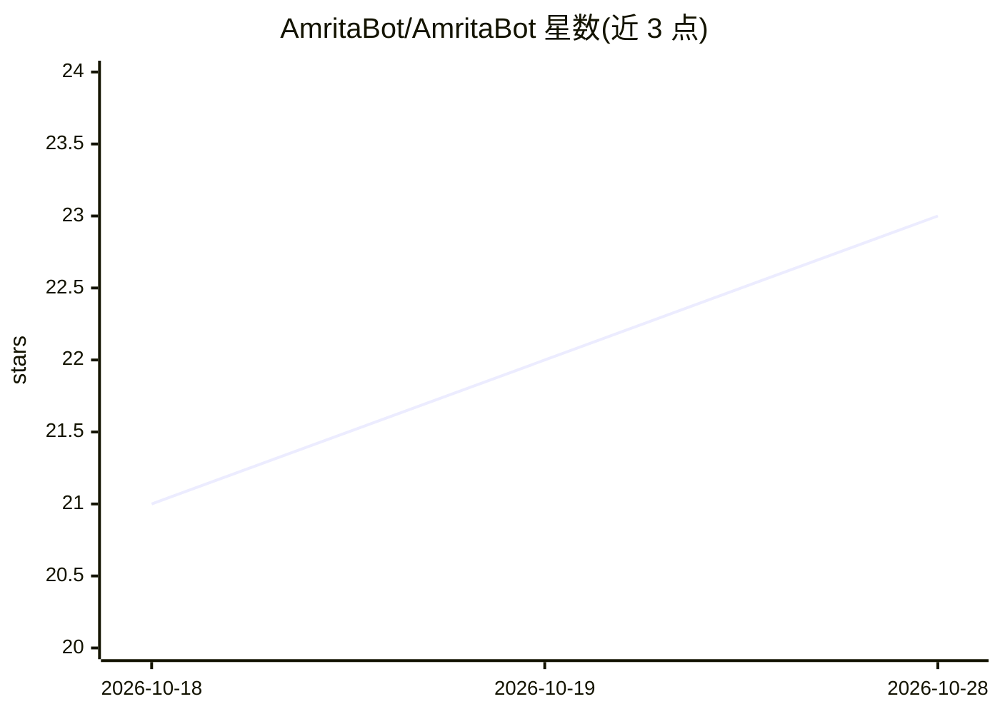

# AmritaBot/AmritaBot

⭐ 23 · Python · AGPL-3.0 · 推送 2026-10-27 · [GitHub](https://github.com/AmritaBot/AmritaBot) · [官网](https://bot.amritabot.com/) · 组织维护 · 中文 README

**基于 NoneBot2 的 LLM 聊天机器人项目，面向 QQ 平台**

基于 NoneBot2 框架与 AmritaCore 构建的 LLM 聊天机器人项目：通过 AmritaCore 接入 Anthropic/OpenAI/DeepSeek/Gemini 等厂商模型，支持 Agent 推理、MCP Client、多模态内容处理与智能会话管理；经 Onebot-V11 协议对接 QQ 等平台。复用 NoneBot2 插件体系，集成 FastAPI + React 19 的 Web UI 可视化管理界面，提供 CLI 工具 amctl 与 uv 安装方式。配置经 .env 注入，开发需 Python 3.10+、uv 与 Bun 1.x。

## 筛选速览

| 维度 | 判定 | 备注 |
|---|---|---|
| AI 角色 | `ai-native` | 本体是模型或模型工具 |
| 许可风险 | `viral` | AGPL-3.0 |
| 部署形态 | `library` | 以包/库形式分发 |
| 模型依赖 | locked-api |  |
| 硬件要求 | — | 无带数字的原话,不猜 |
| 安装摩擦 | `low` | 无编译、无系统依赖或容器化 |
| 成熟度 | — | 结构信号不足 |

## 能力要点

- 基于 AmritaCore 接入 Anthropic/OpenAI/DeepSeek/Gemini 等多种厂商模型
- 支持 Agent 推理与原生 MCP Client 集成
- Onebot-V11 协议对接 QQ 等平台，复用 NoneBot2 插件系统
- FastAPI + React 19 Web UI 与一体化 CLI 管理工具

## 适用场景

- 搭建接入 QQ 平台的 LLM 聊天机器人
- 通过 Web UI 可视化管理机器人配置与会话
- 基于 NoneBot2 插件体系扩展自定义功能

## 场景标签

`聊天机器人` · 领域:对话与助手

## 证据(README 行号)

> L7: Amrita 是一个基于NoneBot2与AmritaCore的强大聊天机器人项目，专为快速构建和部署智能聊天机器人而设计。它是一个完整的 LLM 聊天机器人解决方案，具有强大的功能和灵活性。
> L11: - **供应商无关性**: 基于AmritaCore原生开发，原生支持Anthropic/OpenAI/DeepSeek/Gemini等多种厂商。
> L18: - **Agent**: 支持Agent推理

## 星数曲线

2026-10-18 21 → 2026-10-28 23（+2）

---
*卡片 v1 · prompt 1.4 · 生成 2026-10-28 · 置信度 mid · 依据 README sha `29c5784d33a3` · [字段定义](../../DATASET.md)*
