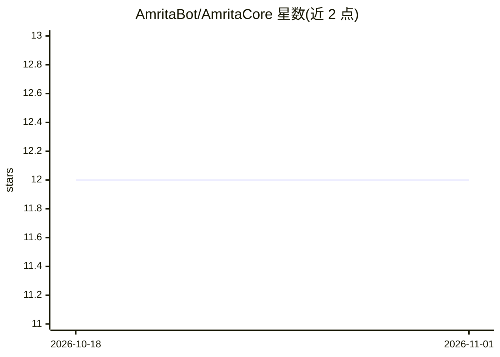

# AmritaBot/AmritaCore

⭐ 12 · Python · Apache-2.0 · 推送 2026-10-29 · [GitHub](https://github.com/AmritaBot/AmritaCore) · [官网](https://core.amritabot.com/) · 组织维护 · 中文 README

**轻量级 Python Agent 运行时框架，用于构建交互式 Agent 应用**

基于 AmritaSense 构建的 Python Agent 运行时框架，提供原生异步流式处理（含挂起/恢复）、厂商无关的适配器系统（OpenAI、Anthropic，可扩展）、声明式依赖注入、事件驱动钩子、工具系统（@simple_tool、@on_tools 与 MCP 客户端支持）以及上下文窗口与 token 的自动内存管理，面向构建生产级交互式 Agent 应用的开发者。以 PyPI 包形式分发，文档位于 core.amritabot.com，采用 Apache 2.0 许可。

## 筛选速览

| 维度 | 判定 | 备注 |
|---|---|---|
| AI 角色 | `ai-ecosystem` | LLM/agent 周边工具 |
| 许可风险 | `permissive` | Apache-2.0 |
| 部署形态 | `library` | 以包/库形式分发 |
| 模型依赖 | — | README 未给出锁定关系 |
| 硬件要求 | — | 无带数字的原话,不猜 |
| 安装摩擦 | `low` | 无编译、无系统依赖或容器化 |
| 成熟度 | — | 结构信号不足 |

## 能力要点

- 原生异步流式处理，支持挂起/恢复
- 厂商无关适配器系统（OpenAI、Anthropic，可扩展）
- 工具系统 @simple_tool、@on_tools 与 MCP 客户端支持
- 上下文窗口与 token 自动优化的内存管理

## 适用场景

- 构建带工具调用与记忆管理的对话式 Agent 应用
- 通过事件钩子拦截和修改 Agent 处理流水线
- 在多个 LLM 厂商 API 间切换而不改动业务代码

## 场景标签

`Agent 框架` · 领域:Agent 开发

## 证据(README 行号)

> L22: AmritaCore is a **lightweight Agent runtime** built on top of **AmritaSense**. It delivers native async streaming, 
> L36: - **Vendor‑agnostic adapter system** — OpenAI, Anthropic, and extensible

## 星数曲线

2026-10-18 12 → 2026-11-01 12（+0）

---
*卡片 v1 · prompt 1.4 · 生成 2026-11-01 · 置信度 high · 依据 README sha `abc167cf4f5e` · [字段定义](../../DATASET.md)*
