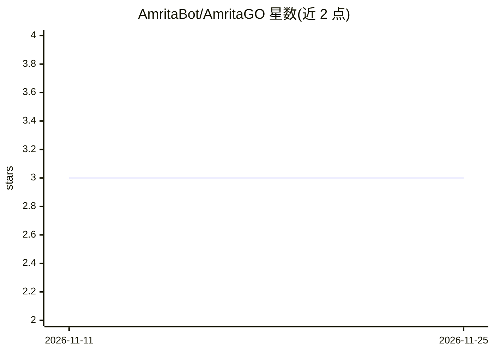

# AmritaBot/AmritaGO

⭐ 3 · Python · AGPL-3.0 · 推送 2026-11-15 · [GitHub](https://github.com/AmritaBot/AmritaGO) · 个人维护 · 中文 README

**本地运行的 Agent 工作台：对话、工具调用、MCP 与插件扩展**

AmritaGO 是本地运行的 Agent 工作台，前端由 React 构建，后端基于 AmritaCore、FastAPI 和 WebSocket。功能覆盖对话、工具调用、Agent 预设（内置预设、项目级/用户级预设）、Skill 系统（目录结构与按需加载）、MCP 与插件扩展。通过 uvx 可临时运行，也支持源码启动；当前处于 Alpha 阶段，接口与配置格式可能变化，README 声明不建议用于生产环境或向公网开放。许可证为 AGPL-3.0-only。

## 筛选速览

| 维度 | 判定 | 备注 |
|---|---|---|
| AI 角色 | `ai-native` | 本体是模型或模型工具 |
| 许可风险 | `viral` | AGPL-3.0 |
| 部署形态 | `None` |  |
| 模型依赖 | — | README 未给出锁定关系 |
| 硬件要求 | — | 无带数字的原话,不猜 |
| 安装摩擦 | `low` | 无编译、无系统依赖或容器化 |
| 成熟度 | `idea` | |

## 能力要点

- 本地运行的 Agent 工作台，提供对话与工具调用
- Agent 预设系统：内置预设、项目级/用户级预设与示例 Agent
- Skill 系统支持目录结构发现与按需加载
- 支持 MCP 与插件扩展，后端基于 AmritaCore/FastAPI/WebSocket

## 适用场景

- 在本地搭建一个可自定义预设的 Agent 工作台
- 通过插件和 MCP 扩展 Agent 的工具能力
- 管理项目级与用户级 Agent 预设

## 场景标签

`Agent 框架` · 领域:Agent 开发

## 证据(README 行号)

> L9: AmritaGO 是本地运行的 Agent 工作台，提供对话、工具调用、Agent 预设、MCP 和插件扩展。前端由 React 构建，后端基于 AmritaCore、FastAPI 和 WebSocket。
> L38: - Agent 预设指南：内置预设、项目级/用户级预设和示例 Agent

## 星数曲线

2026-11-11 3 → 2026-11-25 3（+0）

---
*卡片 v1 · prompt 1.4 · 生成 2026-11-22 · 置信度 high · 依据 README sha `c92df9108e13` · [字段定义](../../DATASET.md)*
