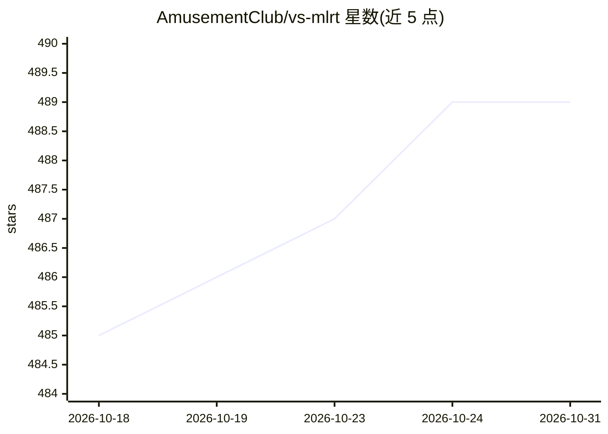

# AmusementClub/vs-mlrt

⭐ 489 · C++ · GPL-3.0 · 推送 2026-10-30 · [GitHub](https://github.com/AmusementClub/vs-mlrt) · 组织维护

**VapourSynth 的多后端 ML 滤镜推理运行时集合**

为 VapourSynth 视频处理框架提供跨平台 AI 滤镜运行时插件：基于 OpenVINO 的纯 CPU/Intel GPU 运行时（vsov）、基于 ONNX Runtime 的 CPU/CUDA 运行时（vsort）、基于 TensorRT 的 NVIDIA GPU 运行时（vstrt）、基于 MIGraphX 的 AMD GPU 运行时（vsmigx）、基于 ncnn 的 Vulkan 运行时（vsncnn）以及 Apple SoC 的 CoreML 运行时。附带 Python 包装 vsmlrt.py，统一接口选择后端并支持 ONNX 到 ncnn 格式的即时转换。安装方式为下载 release 解压至 VS plugins 目录。限制：vstrt 需在本机从 ONNX 构建引擎，vsncnn 速度较慢。

## 筛选速览

| 维度 | 判定 | 备注 |
|---|---|---|
| AI 角色 | `ai-ecosystem` | LLM/agent 周边工具 |
| 许可风险 | `viral` | GPL-3.0 |
| 部署形态 | `None` |  |
| 模型依赖 | — | README 未给出锁定关系 |
| 硬件要求 | — | 无带数字的原话,不猜 |
| 安装摩擦 | `medium` | 含编译或系统依赖之一 |
| 成熟度 | — | 结构信号不足 |

## 能力要点

- 覆盖 x86 CPU、NVIDIA/AMD/Intel GPU、Apple SoC 的多后端推理运行时
- vsmlrt.py 统一接口封装所有内置模型与后端选择
- vsncnn 支持 ONNX 到 ncnn 原生格式的即时转换，依赖 Vulkan 接口
- 内置 waifu2x、RealESRGAN、Real-CUGAN、RIFE 等模型支持

## 适用场景

- 在 VapourSynth 中运行超分辨率、去噪、补帧等 AI 视频滤镜
- 按手头硬件（CPU/各厂 GPU）选择合适的推理后端
- 通过统一 Python 接口在不同后端间切换模型运行

## 场景标签

`图像视频处理` · 领域:感知与多模态

## 证据(README 行号)

> L3: This project provides VapourSynth ML filter runtimes for a variety of platforms:
> L10: To simplify usage, we also provide a Python wrapper vsmlrt.py

## 星数曲线

2026-10-18 485 → 2026-10-31 489（+4）

---
*卡片 v1 · prompt 1.4 · 生成 2026-10-21 · 置信度 high · 依据 README sha `cfae50a3d632` · [字段定义](../../DATASET.md)*
