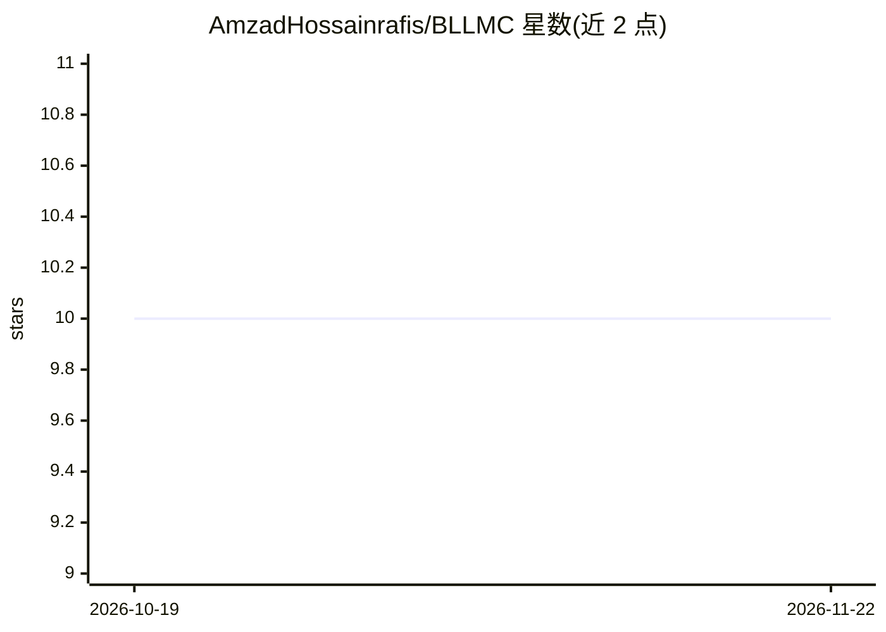

# AmzadHossainrafis/BLLMC

⭐ 10 · Python · MIT · 推送 2026-07-30 · [GitHub](https://github.com/AmzadHossainrafis/BLLMC) · 个人维护

**从零训练与部署孟加拉语 LLM 的 PyTorch 库**

面向孟加拉语场景的模型训练库：内置 GPT-2/Mistral/LLaMA 2/LLaMA 3/GPT-OSS 五种架构实现，提供语料下载、数据切分、训练（AMP、梯度累积、检查点）与推理文本生成全流程。核心机制包括 RoPE、GQA、滑动窗口注意力、稀疏 MoE 及可插拔 tokenizer 后端。要求 Python 3.10+ 与 PyTorch 2.0+，通过 git clone 源码方式安装。

## 筛选速览

| 维度 | 判定 | 备注 |
|---|---|---|
| AI 角色 | `ai-native` | 本体是模型或模型工具 |
| 许可风险 | `permissive` | MIT |
| 部署形态 | `library` | 以包/库形式分发 |
| 模型依赖 | — | README 未给出锁定关系 |
| 硬件要求 | — | 无带数字的原话,不猜 |
| 安装摩擦 | `low` | 无编译、无系统依赖或容器化 |
| 成熟度 | — | 结构信号不足 |

## 能力要点

- 支持 gpt2/mistral/llama2/llama3/gptoss 五种可切换架构预设
- 内置孟加拉语语料自动下载与训练/验证/测试切分流程
- Trainer 支持 AMP 混合精度、梯度累积、余弦退火与检查点
- 可插拔 sentencepiece/tiktoken tokenizer 后端，从 Hugging Face Hub 下载

## 适用场景

- 从零训练一个孟加拉语自回归语言模型
- 在同一代码库中切换不同 attention/MoE 架构做实验
- 用训练好的 checkpoint 运行孟加拉语文本生成

## 场景标签

`模型训练` `推理引擎` · 领域:训练与推理

## 证据(README 行号)

> L9: A highly modular, extensible, and high-performance PyTorch library for training and deploying **Bangla Language Mode
> L27: - 📊 **Bangla-Optimized Data Pipeline**: Built-in corpus downloader, automated train/val/test splitter, and windowed
> L28: - 🚀 **Trainer Design Pattern**: A scalable LLM trainer supporting AMP (automatic mixed precision), Cosine Warmup wi

## 星数曲线

2026-10-19 10 → 2026-11-22 10（+0）

---
*卡片 v1 · prompt 1.4 · 生成 2026-11-20 · 置信度 high · 依据 README sha `cb730c075931` · [字段定义](../../DATASET.md)*
