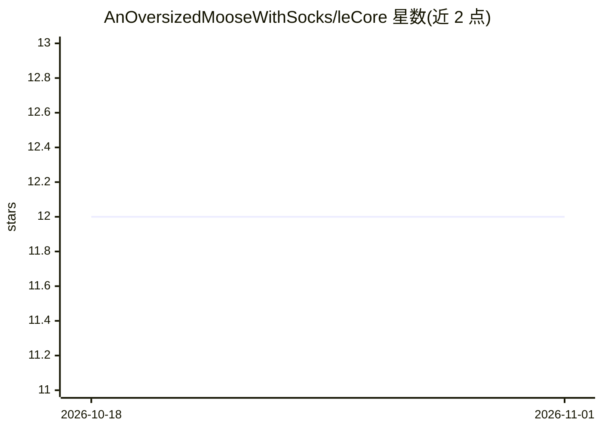

# AnOversizedMooseWithSocks/leCore

⭐ 12 · Python · MIT · 推送 2026-10-26 · [GitHub](https://github.com/AnOversizedMooseWithSocks/leCore) · [官网](https://discoverleos.com/) · 个人维护

**纯 NumPy 的全息向量计算引擎：用超向量统一记忆、几何与物理**

leOS 抽出的核心引擎，用超向量（高维空间中的点）表示记忆、结构化知识、3-D 场景、物理仿真等一切数据，以 bind/bundle/cleanup 三种可逆运算进行计算。纯 NumPy/stdlib，无神经网络与预训练权重，确定性输出。提供联想记忆与溯源回答、3-D 渲染（SDF/点云/路径追踪）、物理仿真、代码与数据问答、类型化决策等能力族，可附加任意模型运行时，并提供 MCP 服务器与 Gradio 聊天界面（run.bat/run.sh）。

## 筛选速览

| 维度 | 判定 | 备注 |
|---|---|---|
| AI 角色 | `ai-ecosystem` | LLM/agent 周边工具 |
| 许可风险 | `permissive` | MIT |
| 部署形态 | `library` | 以包/库形式分发 |
| 模型依赖 | — | README 未给出锁定关系 |
| 硬件要求 | `cpu-ok` | |
| 安装摩擦 | `low` | 无编译、无系统依赖或容器化 |
| 成熟度 | — | 结构信号不足 |

## 能力要点

- bind/bundle/cleanup 三运算统一表示记忆、几何与物理
- 纯 NumPy/stdlib，无神经网络，确定性可复现
- 记忆以 partition 形式跨会话/模型/机器持久化
- 可附加任意模型（attach_runtime/zoo_attach）并提供 MCP 服务器

## 适用场景

- 作为本地 CPU 上的记忆/知识基底挂在语言模型之下
- 运行内置聊天界面做带溯源的问答与教学记忆
- 在同一表示上做 3-D 渲染与物理仿真实验
- 为 agent 提供工具发现、类型化决策与代码问答

## 场景标签

`向量数据库` `Agent 记忆` · 领域:Agent 开发

## 证据(README 行号)

> L3: **The core of leOS, on its own. A from-scratch engine that represents *everything* — memory, meaning, 3-D geometry, 
> L83: Attach any model with `m.attach_runtime(model_dir)` (automatic source attribution,
> L129: - **Serve agents and swarms.** `orient()` is a live compass for any model; `serve()` answers from memory, then fro

## 星数曲线

2026-10-18 12 → 2026-11-01 12（+0）

---
*卡片 v1 · prompt 1.4 · 生成 2026-11-01 · 置信度 high · 依据 README sha `cb80a3b18a77` · [字段定义](../../DATASET.md)*
