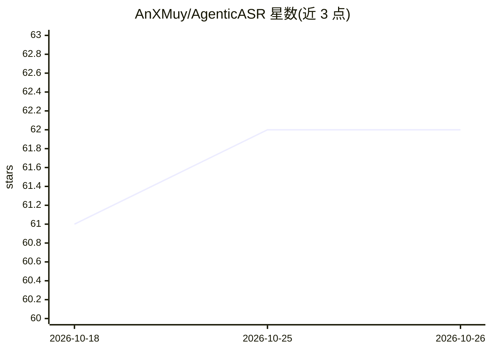

# AnXMuy/AgenticASR

⭐ 62 · Python · Apache-2.0 · 推送 2026-10-15 · [GitHub](https://github.com/AnXMuy/AgenticASR) · [官网](https://anxmuy.github.io/blog/agenticasr/) · 组织维护 · 中文 README

**把 ASR 转写精修为干净书面文本的语音识别研究框架**

研究项目：在任意 ASR 前端输出的文本假设之上运行 Refiner，去除口语不流畅、消解自我修正、规范化书面形式，并可在流式场景下用 K=3 滑窗替换已输出文本。支持中英双语、批处理与流式两种模式，流式系统组合 VAD、sherpa-onnx 在线 ASR 与 MLX-LM 本地后端。附带 AASR-Bench（917 样本、6,637 条原子评分规则），并提供基于 vLLM/OpenRouter 服务的五阶段训练数据生成流水线与 LLaMA Factory 微调流程。面向语音识别研究者与开发者，Apache 2.0 开源。

## 筛选速览

| 维度 | 判定 | 备注 |
|---|---|---|
| AI 角色 | `ai-native` | 本体是模型或模型工具 |
| 许可风险 | `permissive` | Apache-2.0 |
| 部署形态 | `library` | 以包/库形式分发 |
| 模型依赖 | local-ok | 支持本地模型 |
| 硬件要求 | — | 无带数字的原话,不猜 |
| 安装摩擦 | `low` | 无编译、无系统依赖或容器化 |
| 成熟度 | — | 结构信号不足 |

## 能力要点

- ASR 无关的 Refiner，可接到任意产生文本假设的识别器后
- 批处理与流式两种模式，流式采用 K=3 滑窗持续修正
- AASR-Bench：917 样本、6,637 条原子规则覆盖 Content/Format/Filter/Rephrase
- 五阶段训练数据流水线（Oral/Clean 对生成、ASR 假设模拟、质控去重）与 LLaMA Factory 微调

## 适用场景

- 给现有 ASR 系统加后处理，得到去除断句口误的干净转写
- 流式场景下持续修正已输出的转写文本
- 用 AASR-Bench 评测语音转写精修效果
- 复现或训练自己的 Refiner 模型

## 场景标签

`语音识别` `模型评测` `微调` · 领域:评测与运维

## 证据(README 行号)

> L21: **AgenticASR** turns speech into clean written text while preserving the speaker's final intent. It removes disflue
> L24: - **ASR-agnostic:** The Refiner is decoupled from the recognizer and can be attached to any ASR frontend that produ

## 星数曲线

2026-10-18 61 → 2026-10-26 62（+1）

---
*卡片 v1 · prompt 1.4 · 生成 2026-10-24 · 置信度 high · 依据 README sha `b08805622ecf` · [字段定义](../../DATASET.md)*
