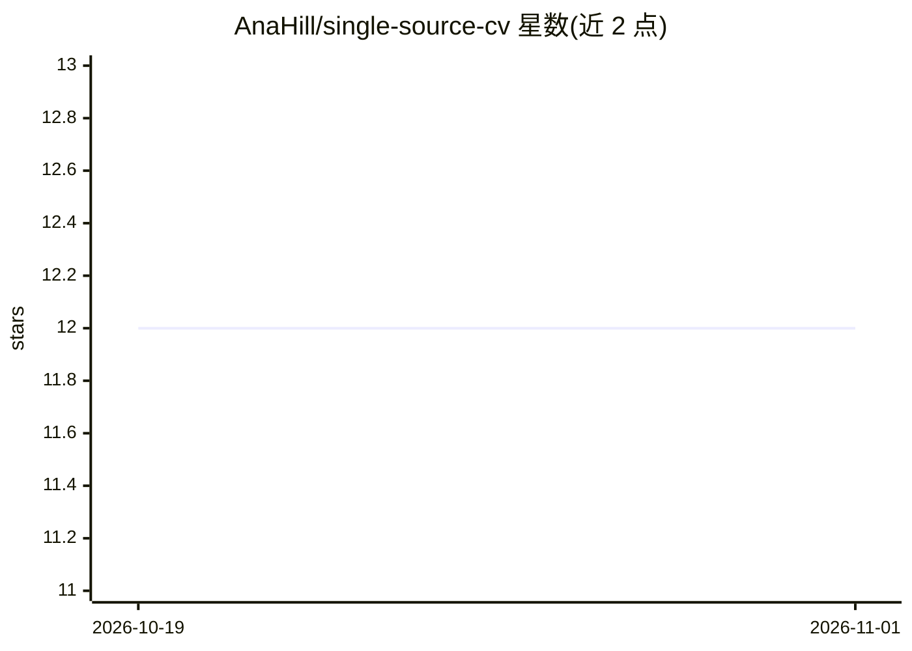

# AnaHill/single-source-cv

⭐ 12 · Python · MIT · 推送 2026-10-18 · [GitHub](https://github.com/AnaHill/single-source-cv) · 个人维护

**单一 YAML 源生成多版本简历与求职匹配分析**

以 data/cv.yml 为唯一数据源的简历模板仓库：build.py 用 Jinja2 生成网站 markdown（兼容 GitHub Pages/Jekyll），用 Typst 生成多档案×多语言 PDF（含 ATS 单栏版、单页版、内部版）。可选配合 Claude Code 等编程 agent 做逐条岗位匹配分析（差距、缺失 ATS 关键词、定制简历档案），指令内置无需 API key。仓库声明为模板、非积极维护；README 详述 agent 读取内部数据（NDA 客户名等）并送往模型提供商的隐私边界。

## 筛选速览

| 维度 | 判定 | 备注 |
|---|---|---|
| AI 角色 | `ai-enhanced` | 去掉 AI 部分产品仍成立 |
| 许可风险 | `permissive` | MIT |
| 部署形态 | `library` | 以包/库形式分发 |
| 模型依赖 | — | README 未给出锁定关系 |
| 硬件要求 | — | 无带数字的原话,不猜 |
| 安装摩擦 | `low` | 无编译、无系统依赖或容器化 |
| 成熟度 | `idea` | |

## 能力要点

- 一个 YAML 文件生成网站页与多档案×多语言 PDF（含 ATS 版）
- 岗位逐条匹配分析（✅/🟡/❌/❔）与定制简历档案生成
- 内部字段（真实客户名）与公开输出分离的 internal 变体
- GitHub Actions CI 构建并默认排除内部档案

## 适用场景

- 维护网站、完整 PDF、单页版等多个简历版本并保持一致
- 投递前对招聘广告做逐条匹配与差距分析
- 同一份双语简历按语言输出

## 场景标签

 · 领域:个人文档/求职工具

## 证据(README 行号)

> L3: **One YAML file → your website CV page + several tailored PDF CVs, in several languages.**
> L22: - 🎯 **Job fit analysis with your coding agent:** drop a job ad into `jobs/<slug>/` and get a requirement-by-require
> L52: - Optional: a **coding agent** such as Claude Code for the job fit analysis (instructions in `AGENTS.md` and `.clau

## 星数曲线

2026-10-19 12 → 2026-11-01 12（+0）

---
*卡片 v1 · prompt 1.4 · 生成 2026-11-01 · 置信度 mid · 依据 README sha `7962a380e52e` · [字段定义](../../DATASET.md)*
