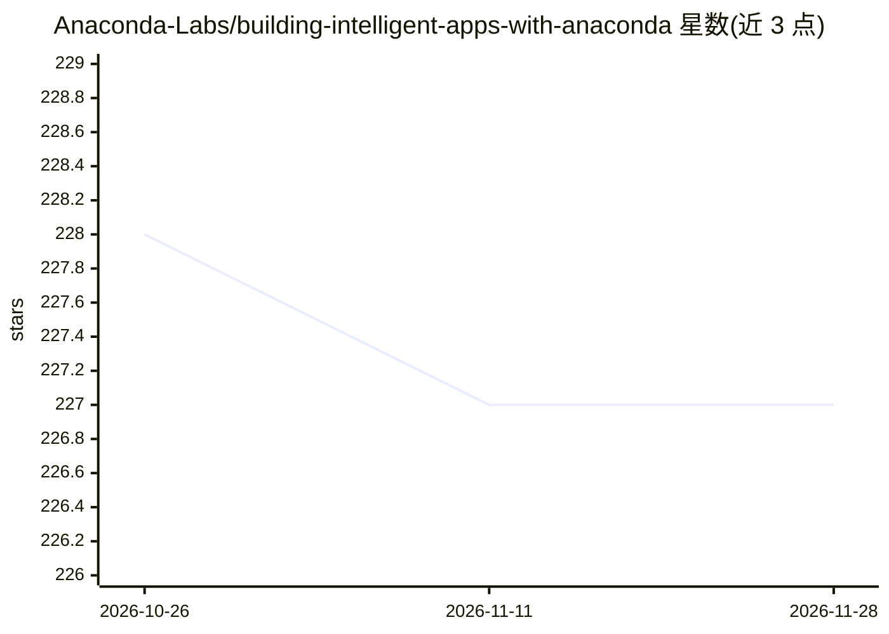

# Anaconda-Labs/building-intelligent-apps-with-anaconda

⭐ 227 · Jupyter Notebook · MIT · 推送 2026-11-23 · [GitHub](https://github.com/Anaconda-Labs/building-intelligent-apps-with-anaconda) · [官网](https://www.anaconda.com/docs/getting-started) · 组织维护

**用 Anaconda 生态构建 AI 应用的 10 模块实操教程**

以 NASA TESS 观测的系外行星 WASP-18 b 光变曲线为贯穿数据的实操课程，共 10 个模块：conda 环境管理、数据管线（Polars/Pydantic/IsolationForest）、LangGraph 单/多 Agent、LLM 端点切换部署（AI Navigator/vLLM/Anaconda Platform）、CUDA 加速、Metaflow 生产加固（降级/评估/可观测/记忆）、供应链安全（conda-lockfiles、CVE 扫描、conda-pack、AIBOM）、PyScript/BeeWare/Panel 交付。每模块为自包含、约 7 分钟的演示，附 run_demo.sh 与预运行输出，针对 GitHub Codespaces 优化。

## 筛选速览

| 维度 | 判定 | 备注 |
|---|---|---|
| AI 角色 | `ai-knowledge` | 知识聚合/清单类 |
| 许可风险 | `permissive` | MIT |
| 部署形态 | `desktop` | 安装包/桌面程序 |
| 模型依赖 | local-ok | 支持本地模型 |
| 硬件要求 | — | 无带数字的原话,不猜 |
| 安装摩擦 | `medium` | 含编译或系统依赖之一 |
| 成熟度 | — | 结构信号不足 |

## 能力要点

- 10 个自包含模块，同一真实 TESS 光变曲线数据贯穿全程
- LangGraph 多 Agent 架构 + Metaflow 生产化模式（@catch/@card/eval 步骤）
- LLM 端点经环境变量一行切换：本地、自托管 vLLM、企业平台
- 五层供应链安全：锁定、CVE 扫描、策略门禁、conda-pack 离线分发、AIBOM

## 适用场景

- 学习用 Anaconda/conda 生态搭建生产级 AI Agent 应用
- 了解本地、自托管与企业 LLM 推理端点的部署差异
- 构建可复现、可安全审计的 AI 数据管线

## 场景标签

`教程课程` · 领域:学习与行业

## 证据(README 行号)

> L7: A hands-on curriculum for building production-grade intelligent applications with the Anaconda ecosystem. Every modu
> L9: Our data is real: WASP-18 b, a hot Jupiter exoplanet caught transiting its star by NASA's TESS telescope. We process
> L30: ## 📡 Modules

## 星数曲线

2026-10-26 228 → 2026-11-28 227（-1）

---
*卡片 v1 · prompt 1.4 · 生成 2026-11-25 · 置信度 mid · 依据 README sha `0a12e3a88930` · [字段定义](../../DATASET.md)*
