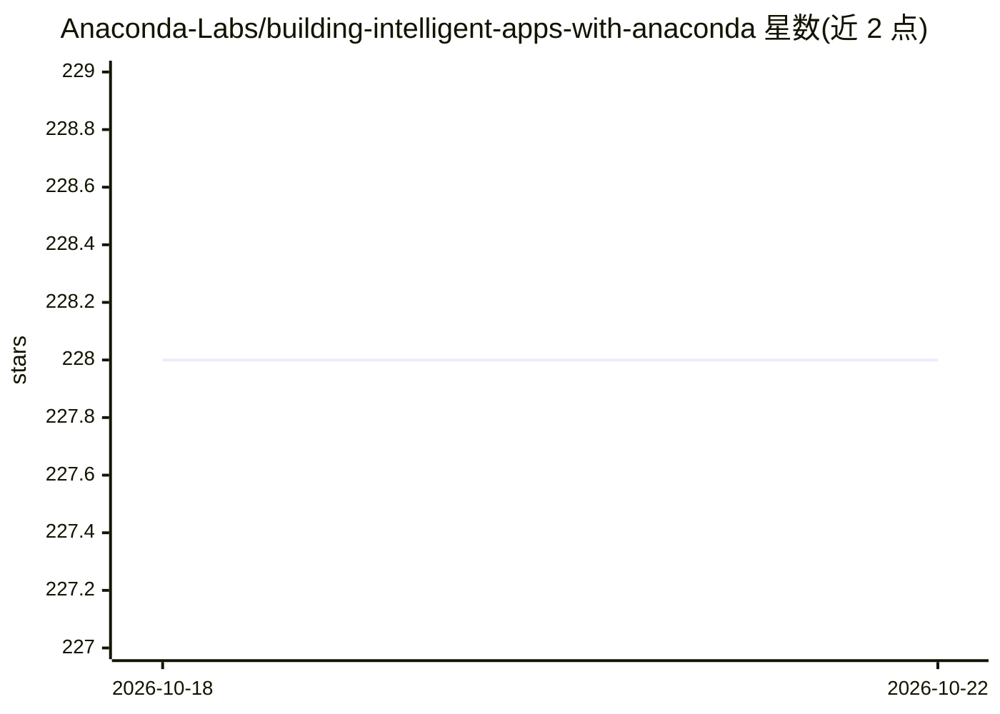

# Anaconda-Labs/building-intelligent-apps-with-anaconda

⭐ 228 · Jupyter Notebook · MIT · 推送 2026-10-19 · [GitHub](https://github.com/Anaconda-Labs/building-intelligent-apps-with-anaconda) · [官网](https://www.anaconda.com/docs/getting-started) · 组织维护

**用 Anaconda 生态构建 AI 原生应用的 10 模块实践课程**

Anaconda Labs 出品的动手教程：以 NASA TESS 望远镜观测的真实系外行星 WASP-18 b 光变曲线为贯穿数据，依次讲授 conda 环境管理、Polars 数据管线、LangGraph 单/多 Agent、vLLM/AI Navigator/Anaconda Platform 三种推理端点切换、CUDA Python GPU 加速、生产化模式（降级/评测/可观测/记忆）、供应链安全（conda-lockfiles/审计/AIBOM）、PyScript/BeeWare 原生应用与 Panel Web 应用。每模块为 <7 分钟带讲解的演示，含预跑输出或 run_demo.sh 脚本，多数可在 GitHub Codespaces 完成；GPU 模块依赖付费服务 Brev。

## 筛选速览

| 维度 | 判定 | 备注 |
|---|---|---|
| AI 角色 | `ai-knowledge` | 知识聚合/清单类 |
| 许可风险 | `permissive` | MIT |
| 部署形态 | `desktop` | 安装包/桌面程序 |
| 模型依赖 | — | README 未给出锁定关系 |
| 硬件要求 | — | 无带数字的原话,不猜 |
| 安装摩擦 | `medium` | 含编译或系统依赖之一 |
| 成熟度 | `idea` | |

## 能力要点

- 同一份 WASP-18 b 光变曲线数据贯穿全部 10 个模块
- Module 04 演示 openai 客户端在一行 env var 内切换 vLLM/AI Navigator/Anaconda Platform 三种推理端点
- 供应链安全模块覆盖 conda-lockfiles、anaconda-audit CVE 扫描与 conda-pack 离线交付
- Module 05 报告 CUDA Python 内核带来 47.5× 特征工程加速（50 条光变曲线基准）

## 适用场景

- 按模块学习从数据分析到多 Agent 部署的完整 AI 应用构建流程
- 了解如何在 GPU、浏览器、原生应用、Web 应用等不同目标上复用同一管线
- 参考 conda 环境锁定、CVE 审计与 AIBOM 的供应链安全实践

## 场景标签

`教程课程` · 领域:学习与行业

## 证据(README 行号)

> L7: A hands-on curriculum for building production-grade intelligent applications with the Anaconda ecosystem. Every modu
> L9: Our data is real: WASP-18 b, a hot Jupiter exoplanet caught transiting its star by NASA's TESS telescope. We process

## 星数曲线

2026-10-18 228 → 2026-10-22 228（+0）

---
*卡片 v1 · prompt 1.4 · 生成 2026-10-22 · 置信度 mid · 依据 README sha `e248dbb4396a` · [字段定义](../../DATASET.md)*
