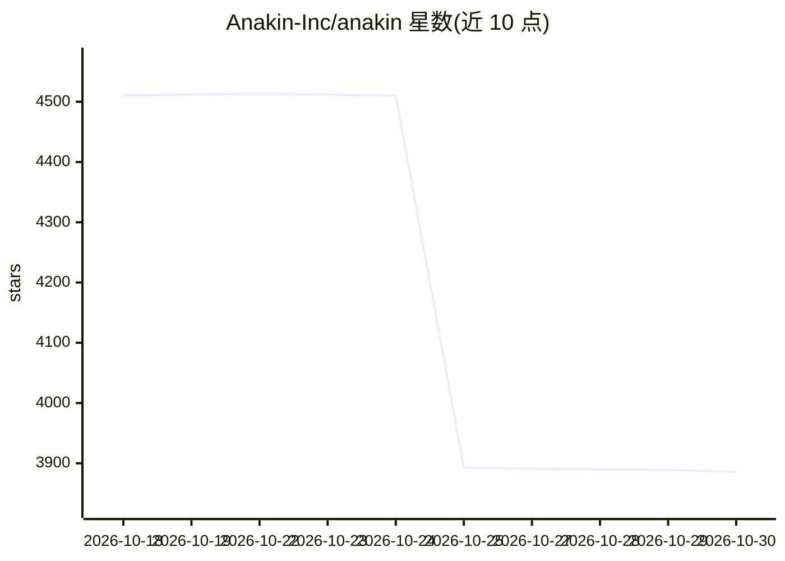

# Anakin-Inc/anakin

⭐ 3,886 · Go · AGPL-3.0 · 推送 2026-08-18 · [GitHub](https://github.com/Anakin-Inc/anakin) · [官网](https://anakin.io) · 组织维护

**自托管网页抓取 API：把任意网页转成 markdown/结构化 JSON 供 AI 使用**

用 Go 编写的开源网页抓取服务，提供同步/异步/批量 REST API，把网页转换为去除样板内容的 LLM-ready markdown；可通过 Gemini API key（自带密钥）做结构化 JSON 抽取。核心机制是处理链回退：本地 HTTP → Camoufox 反检测浏览器（Playwright 协议）→ 可选第三方 API；代理选择用 Thompson Sampling 学习。零配置模式下仅需 Go 1.25+，内存存储、重启即失；Docker 全栈含 PostgreSQL 与浏览器服务，另带 React Web 控制台与 OpenClaw 技能集成。面向需要为 RAG、AI agent 供数的开发者。

## 筛选速览

| 维度 | 判定 | 备注 |
|---|---|---|
| AI 角色 | `ai-ecosystem` | LLM/agent 周边工具 |
| 许可风险 | `viral` | AGPL-3.0 |
| 部署形态 | `self-host` | docker 或自建部署 |
| 模型依赖 | — | README 未给出锁定关系 |
| 硬件要求 | — | 无带数字的原话,不猜 |
| 安装摩擦 | `low` | 无编译、无系统依赖或容器化 |
| 成熟度 | — | 结构信号不足 |

## 能力要点

- HTTP → 反检测浏览器 → API 的处理链自动回退
- Thompson Sampling 代理自动选择，按域学习成败
- Camoufox（Firefox）反检测浏览器 + 域级抓取策略配置
- 单 Go 二进制零依赖运行，Docker 全栈 make up 一条命令启动

## 适用场景

- 为 RAG 管线和 AI agent 提供网页转 markdown 数据源
- 抓取有反爬/JS 渲染的站点并自动回退处理
- 通过内置 Web 控制台管理抓取任务与域配置

## 场景标签

`网页抓取` · 领域:效率与自动化

## 证据(README 行号)

> L10: The open-source web scraping API for AI. Turn any website into LLM-ready markdown or structured data.
> L12: Self-host with a single command. No cloud dependencies. Powers RAG pipelines, AI agents, and data extraction at sca

## 星数曲线

2026-10-18 4,511 → 2026-10-30 3,886（-625）

---
*卡片 v1 · prompt 1.4 · 生成 2026-10-20 · 置信度 high · 依据 README sha `8323314b46e9` · [字段定义](../../DATASET.md)*
