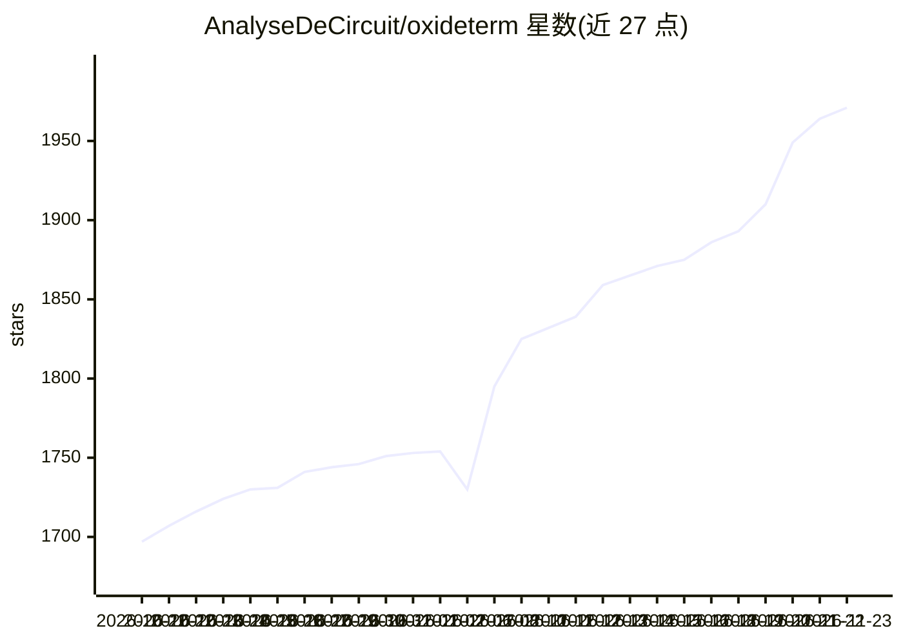

# AnalyseDeCircuit/oxideterm

⭐ 1,971 · Rust · GPL-3.0 · 推送 2026-11-22 · [GitHub](https://github.com/AnalyseDeCircuit/oxideterm) · [官网](https://oxideterm.app) · 个人维护 · 中文 README

**给运维和开发者的原生多协议远程工作区客户端**

用 Rust 与 GPUI 构建的 SSH 客户端，覆盖 macOS、Windows 和 Linux，无 WebView 与遥测。每个服务器连接对应一个工作区，聚合终端、SFTP 文件管理、端口转发、远程 IDE、主机监控与远程桌面（RDP/VNC，插件形式）。支持从 ~/.ssh/config 及 SecureCRT、Xshell、Termius 等客户端导入连接，会话按组管理。AI 部分为可选的 OxideSens 助手，使用用户自选的供应商与 API key。以 GPL-3.0 开源，提供安装包下载。

## 筛选速览

| 维度 | 判定 | 备注 |
|---|---|---|
| AI 角色 | `ai-enhanced` | 去掉 AI 部分产品仍成立 |
| 许可风险 | `viral` | GPL-3.0 |
| 部署形态 | `desktop` | 安装包/桌面程序 |
| 模型依赖 | local-ok | 支持本地模型 |
| 硬件要求 | — | 无带数字的原话,不猜 |
| 安装摩擦 | `low` | 无编译、无系统依赖或容器化 |
| 成熟度 | — | 结构信号不足 |

## 能力要点

- 单窗口工作区聚合终端、SFTP、端口转发、IDE 与主机监控
- 原生 GPUI 渲染，空闲内存约 81 MB（macOS）/24 MB（Windows）
- 纯 Rust SSH 栈（russh + ring），不依赖 OpenSSL/libssh2
- 支持从 ~/.ssh/config 及 8 种其他客户端导入连接

## 适用场景

- 用带断线恢复的 SSH 终端管理多台远程服务器
- 在同一工作区内进行双栏 SFTP 传文件和远程代码编辑
- 通过一键转发快速访问服务器上监听的服务端口
- 自带 key 接入 AI 助手辅助操作

## 场景标签

`AI 助手` · 领域:对话与助手

## 证据(README 行号)

> L28: OxideTerm is an SSH client for macOS, Windows and Linux. Each server you connect to gets its own workspace in one w
> L35: - **Bring your own AI.** The OxideSens assistant runs on the provider and API key you choose. There are no OxideTer

## 星数曲线

2026-10-21 1,697 → 2026-11-23 1,971（+274）

---
*卡片 v1 · prompt 1.4 · 生成 2026-11-23 · 置信度 high · 依据 README sha `b751cbf19699` · [字段定义](../../DATASET.md)*
