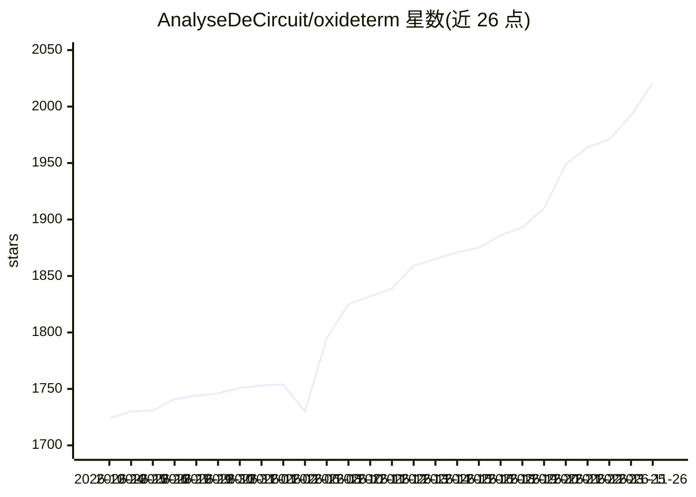

# AnalyseDeCircuit/oxideterm

⭐ 2,021 · Rust · GPL-3.0 · 推送 2026-11-25 · [GitHub](https://github.com/AnalyseDeCircuit/oxideterm) · [官网](https://oxideterm.app) · 组织维护 · 中文 README

**给运维与开发者的本地优先 SSH 客户端，集成可选 AI 助手**

基于 Rust 与 GPUI 的原生 SSH 客户端，支持 macOS/Windows/Linux，无 WebView、无遥测，GPL-3.0 开源。每个服务器连接对应一个工作区，包含终端、SFTP 文件管理、端口转发、代码编辑器、主机监控；支持 Mosh、Telnet、串口、RDP/VNC、SSH 配置导入及多客户端会话迁移。内置 OxideSens AI 助手按 BYO-key 方式运行于用户自选的模型服务商，无内置计费；多项功能（RDP/VNC、FIDO 密钥等）以插件形式提供。

## 筛选速览

| 维度 | 判定 | 备注 |
|---|---|---|
| AI 角色 | `ai-enhanced` | 去掉 AI 部分产品仍成立 |
| 许可风险 | `viral` | GPL-3.0 |
| 部署形态 | `desktop` | 安装包/桌面程序 |
| 模型依赖 | local-ok | 支持本地模型 |
| 硬件要求 | — | 无带数字的原话,不猜 |
| 安装摩擦 | `low` | 无编译、无系统依赖或容器化 |
| 成熟度 | — | 结构信号不足 |

## 能力要点

- 单窗口多服务器工作区：终端、SFTP、端口转发、IDE 共享一条 SSH 连接
- OxideSens AI 助手支持自带 API key，无平台积分计费
- GPUI 原生渲染，空闲内存约 24–81 MB（2.0 相对 1.x Tauri 版下降 74–87%）
- 插件市场扩展：RDP/VNC、FIDO 安全密钥、Mosh 等

## 适用场景

- 在一个窗口里管理多台远程服务器的终端、文件与端口转发
- 从 SecureCRT/Xshell/Termius 等客户端迁移现有会话配置
- 网络闪断后自动恢复会话，保持 vim/htop 等全屏程序运行
- 用自选模型的 AI 助手辅助服务器操作

## 场景标签

`AI 助手` · 领域:对话与助手

## 证据(README 行号)

> L28: OxideTerm is an SSH client for macOS, Windows and Linux. Each server you connect to gets its own workspace in one w
> L35: - **Bring your own AI.** The OxideSens assistant runs on the provider and API key you choose. There are no OxideTer

## 星数曲线

2026-10-24 1,724 → 2026-11-26 2,021（+297）

---
*卡片 v1 · prompt 1.4 · 生成 2026-11-26 · 置信度 mid · 依据 README sha `652ad0e3cabe` · [字段定义](../../DATASET.md)*
