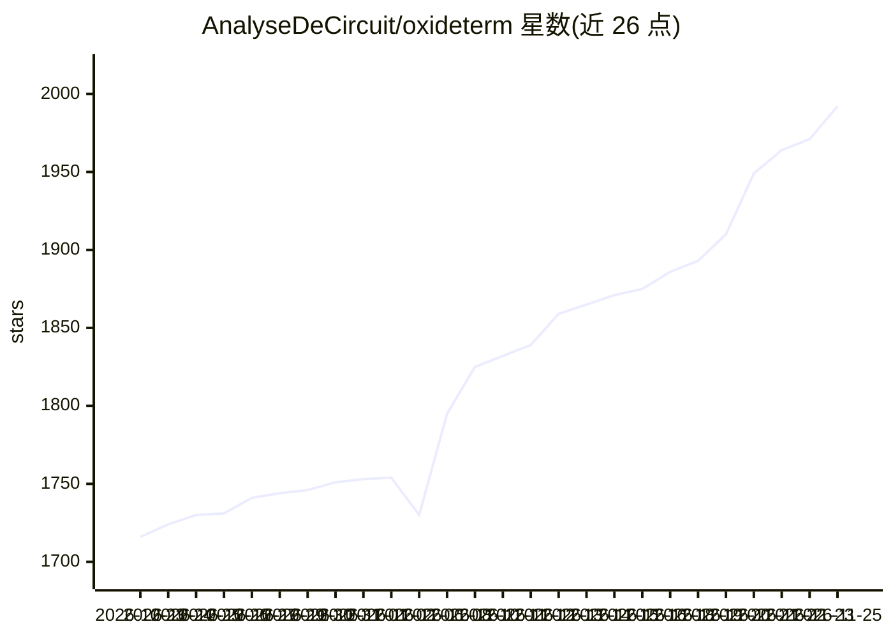

# AnalyseDeCircuit/oxideterm

⭐ 1,992 · Rust · GPL-3.0 · 推送 2026-11-23 · [GitHub](https://github.com/AnalyseDeCircuit/oxideterm) · [官网](https://oxideterm.app) · 个人维护 · 中文 README

**面向服务器运维者的开源原生 SSH 多合一工作区客户端**

macOS/Windows/Linux 上的 SSH 客户端，每个连接对应一个工作区，整合终端、SFTP 文件管理、端口转发、远程代码编辑、主机监控与远程桌面（RDP/VNC，插件形式）。基于 Rust 与 GPUI 绘制界面、无 WebView，SSH 栈用 russh/ring 实现，不依赖 OpenSSL。支持 Mosh、Telnet、串口，可从 ~/.ssh/config 及多款客户端导入连接。内置 OxideSens AI 助手为可选功能，使用用户自选的提供商与 API key。GPL-3.0 开源，无遥测。

## 筛选速览

| 维度 | 判定 | 备注 |
|---|---|---|
| AI 角色 | `ai-enhanced` | 去掉 AI 部分产品仍成立 |
| 许可风险 | `viral` | GPL-3.0 |
| 部署形态 | `desktop` | 安装包/桌面程序 |
| 模型依赖 | — | README 未给出锁定关系 |
| 硬件要求 | — | 无带数字的原话,不猜 |
| 安装摩擦 | `low` | 无编译、无系统依赖或容器化 |
| 成熟度 | — | 结构信号不足 |

## 能力要点

- 单窗口多服务器工作区：终端、SFTP、端口转发、IDE 共享一条 SSH 连接
- Rust + GPUI 原生渲染，无 WebView，空闲内存约 24–81 MB
- 支持 SSH/Mosh/Telnet/串口/RDP/VNC 及多种密钥与代理认证方式
- OxideSens 助手按用户自带提供商与 API key 运行

## 适用场景

- 用一个客户端统一管理大量服务器的终端、文件与转发
- 网络不稳定环境下保持 vim/htop 等全屏程序会话
- 在远程项目上进行编辑并查看主机资源监控
- 把其他 SSH 客户端的既有连接配置迁移过来

## 场景标签

`AI 助手` · 领域:对话与助手

## 证据(README 行号)

> L28: OxideTerm is an SSH client for macOS, Windows and Linux. Each server you connect to gets its own workspace in one w
> L35: - **Bring your own AI.** The OxideSens assistant runs on the provider and API key you choose. There are no OxideTer

## 星数曲线

2026-10-23 1,716 → 2026-11-25 1,992（+276）

---
*卡片 v1 · prompt 1.4 · 生成 2026-11-24 · 置信度 high · 依据 README sha `55f5aee62d12` · [字段定义](../../DATASET.md)*
