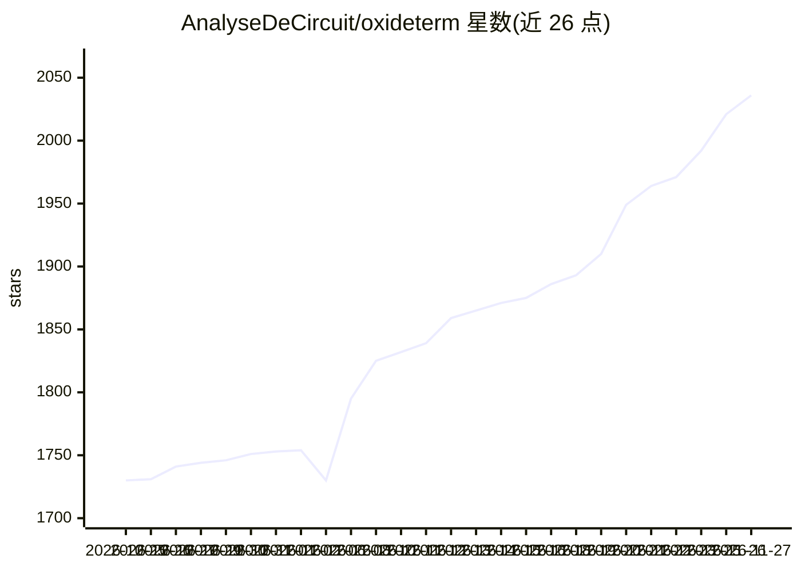

# AnalyseDeCircuit/oxideterm

⭐ 2,036 · Rust · GPL-3.0 · 推送 2026-11-26 · [GitHub](https://github.com/AnalyseDeCircuit/oxideterm) · [官网](https://oxideterm.app) · 组织维护 · 中文 README

**面向服务器运维者的原生 SSH 多协议工作区客户端**

基于 Rust 与 GPUI 构建的 SSH 客户端，覆盖 macOS、Windows 与 Linux，不依赖 WebView/Electron。每个服务器连接对应一个工作区，整合终端、SFTP 文件管理、端口转发、远程 IDE、主机监控、RDP/VNC 远程桌面与插件市场；支持从 ~/.ssh/config 及 SecureCRT、Xshell、Termius 等多种客户端导入会话。内置 OxideSens AI 助手采用自带 API key 模式，不销售积分。GPL-3.0 开源，无遥测，提供安装包、Homebrew 与源码构建。

## 筛选速览

| 维度 | 判定 | 备注 |
|---|---|---|
| AI 角色 | `ai-enhanced` | 去掉 AI 部分产品仍成立 |
| 许可风险 | `viral` | GPL-3.0 |
| 部署形态 | `desktop` | 安装包/桌面程序 |
| 模型依赖 | local-ok | 支持本地模型 |
| 硬件要求 | — | 无带数字的原话,不猜 |
| 安装摩擦 | `low` | 无编译、无系统依赖或容器化 |
| 成熟度 | — | 结构信号不足 |

## 能力要点

- 单一 SSH 连接共享终端、SFTP、转发与编辑器
- GPUI 原生渲染，空闲内存约 81 MB（macOS）
- 支持 Mosh、Telnet、串口、RDP/VNC 与蓝牙 LE 终端
- OxideSens AI 助手自带 provider 与 API key，可接入 MCP 工具

## 适用场景

- 用一个窗口管理多台服务器的终端、文件与转发
- 从其他 SSH 客户端批量导入已有会话配置
- 远程编辑服务器上的项目文件并查看主机监控
- 网络不稳定时保持会话并在重连后恢复转发与传输

## 场景标签

 · 领域:开发者工具/远程服务器管理

## 证据(README 行号)

> L28: OxideTerm is an SSH client for macOS, Windows and Linux. Each server you connect to gets its own workspace in one w
> L35: - **Bring your own AI.** The OxideSens assistant runs on the provider and API key you choose. There are no OxideTer
> L229: ### OxideSens AI

## 星数曲线

2026-10-25 1,730 → 2026-11-27 2,036（+306）

---
*卡片 v1 · prompt 1.4 · 生成 2026-11-27 · 置信度 high · 依据 README sha `b98e70daac29` · [字段定义](../../DATASET.md)*
