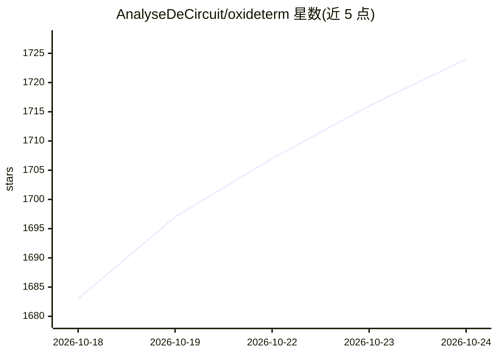

# AnalyseDeCircuit/oxideterm

⭐ 1,724 · Rust · GPL-3.0 · 推送 2026-10-23 · [GitHub](https://github.com/AnalyseDeCircuit/oxideterm) · [官网](https://oxideterm.app) · 组织维护 · 中文 README

**带 BYOK AI 助手的原生 SSH 客户端与远程运维工作台**

用 Rust+GPUI 编写的桌面 SSH 客户端与远程操作工作台，覆盖 SSH/Mosh/Telnet/Serial/RDP/VNC/SFTP、端口转发、tmux 控制模式、内置编辑器与主机监控，终端、文件、转发共享同一 SSH 连接池。AI 部分为可选的 OxideSens 助手：自带 API key 接入 OpenAI/Anthropic/Gemini/Ollama 或 OpenAI 兼容端点，支持 MCP、Agent Skills、本地 RAG（BM25+HNSW），动作需用户批准，发送前做凭据脱敏。SSH 栈为纯 Rust（russh+ring）。仅桌面端（macOS/Windows/Linux）。

## 筛选速览

| 维度 | 判定 | 备注 |
|---|---|---|
| AI 角色 | `ai-enhanced` | 去掉 AI 部分产品仍成立 |
| 许可风险 | `viral` | GPL-3.0 |
| 部署形态 | `desktop` | 安装包/桌面程序 |
| 模型依赖 | local-ok | 支持本地模型 |
| 硬件要求 | — | 无带数字的原话,不猜 |
| 安装摩擦 | `low` | 无编译、无系统依赖或容器化 |
| 成熟度 | — | 结构信号不足 |

## 能力要点

- 多协议会话：SSH/Mosh/Telnet/Serial/RDP/VNC/SFTP，多跳路由与 Grace Period 断线重连
- OxideSens BYOK AI 助手：支持 OpenAI/Anthropic/Gemini/Ollama/兼容端点，MCP、本地 RAG、动作批准制
- GPU 渲染原生界面（GPUI），无 Electron/WebView，SSH 栈为纯 Rust（russh+ring）
- 三种插件路径（Manifest/WASM/Process）与独立 headless CLI

## 适用场景

- 在一个工作台里管理服务器的终端、文件传输、端口转发与远程桌面
- 运维时让 AI 助手检查会话并执行经批准的操作
- 跨平台本地优先使用 SSH，无需账号订阅与遥测

## 场景标签

`AI 助手` · 领域:对话与助手

## 证据(README 行号)

> L5: **A free, native SSH client and remote operations workspace with a bring-your-own-key AI assistant.**
> L28: 5. **Optional: turn on AI.** In Settings, add your own OpenAI, Anthropic, Gemini, Ollama, or OpenAI-compatible endp
> L88: OxideSens is an optional assistant that can inspect your live sessions and perform workspace actions **only after y

## 星数曲线

2026-10-18 1,683 → 2026-10-24 1,724（+41）

---
*卡片 v1 · prompt 1.4 · 生成 2026-10-21 · 置信度 high · 依据 README sha `4f2588e38c75` · [字段定义](../../DATASET.md)*
