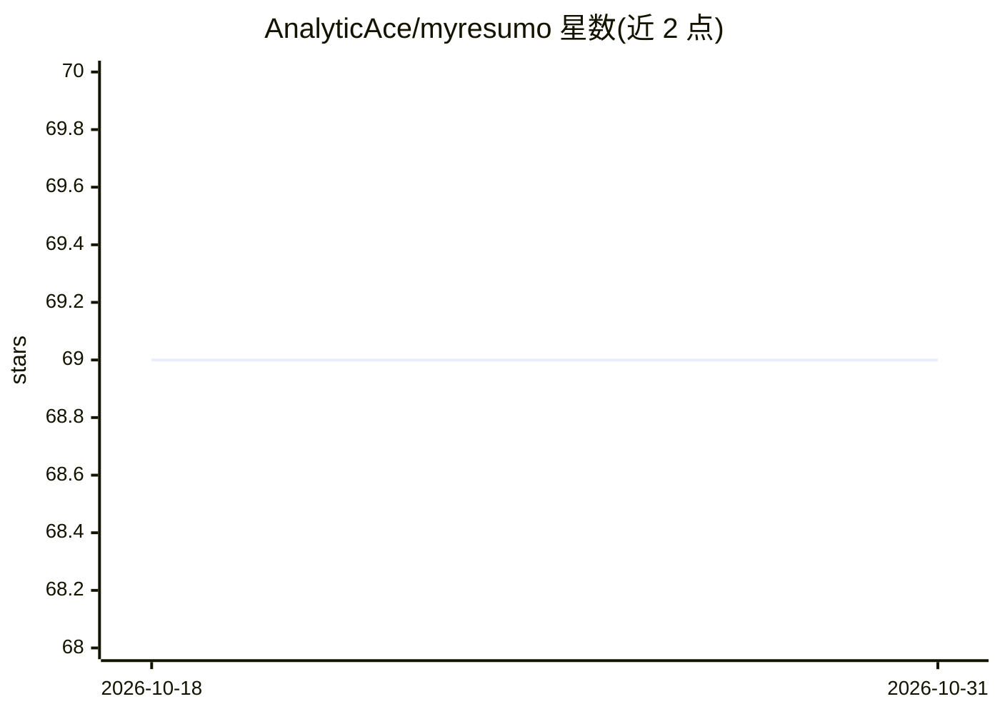

# AnalyticAce/myresumo

⭐ 69 · HTML · MIT · 推送 2026-09-15 · [GitHub](https://github.com/AnalyticAce/myresumo) · 个人维护

**AI 简历定制平台：按职位描述自动改写简历并优化 ATS 匹配**

基于 FastAPI + MongoDB 的 Web 平台，读取 PDF/DOCX 简历与职位描述，通过 LLM（默认 Deepseek API）生成针对职位的定制简历，并提供 ATS 关键词优化、技能缺口分析与多版本管理，支持导出下载。后端为 FastAPI/Jinja2/Alpine.js，通过 Docker 镜像或源码部署，需自备 Deepseek API key 与 MongoDB 实例。README 自述处于 Beta 状态，并提示 LLM 输出可能不可预测需人工审核。

## 筛选速览

| 维度 | 判定 | 备注 |
|---|---|---|
| AI 角色 | `ai-native` | 本体是模型或模型工具 |
| 许可风险 | `permissive` | MIT |
| 部署形态 | `self-host` | docker 或自建部署 |
| 模型依赖 | locked-api |  |
| 硬件要求 | — | 无带数字的原话,不猜 |
| 安装摩擦 | `low` | 无编译、无系统依赖或容器化 |
| 成熟度 | `idea` | |

## 能力要点

- 按职位描述生成定制简历并优化 ATS 关键词匹配
- 技能缺口分析：识别职位描述中缺失的技能
- 简历多版本管理与多格式导出
- 支持通过环境变量切换不同 AI 后端

## 适用场景

- 针对心仪职位快速生成定制化简历
- 检查自己的简历与目标职位的关键词差距
- 管理投递不同职位的多版本简历

## 场景标签

`AI 写作` · 领域:内容生成

## 证据(README 行号)

> L13: **MyResumo** is an AI-powered resume customization platform that tailors your professional profile to match specifi
> L17: - **AI-Powered Resume Customization**: Automatically tailors your resume content to match job requirements

## 星数曲线

2026-10-18 69 → 2026-10-31 69（+0）

---
*卡片 v1 · prompt 1.4 · 生成 2026-10-24 · 置信度 mid · 依据 README sha `f39a20267c71` · [字段定义](../../DATASET.md)*
