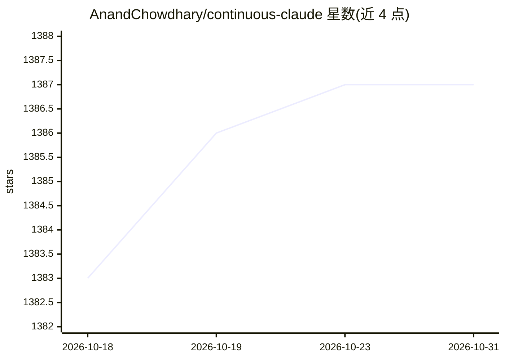

# AnandChowdhary/continuous-claude

⭐ 1,387 · Shell · MIT · 推送 2026-10-29 · [GitHub](https://github.com/AnandChowdhary/continuous-claude) · [官网](https://anandchowdhary.com/open-source/2025/continuous-claude) · 个人维护

**让 Claude Code 持续循环自主建 PR、等检查并合并的 CLI**

Bash/PowerShell 编排脚本，将 Claude Code 或 Codex CLI 置于循环中：每轮迭代新建分支、由 AI agent 生成提交、经 gh CLI 创建 PR、等待 CI 检查与代码评审，通过则合并、失败则丢弃并重试；用 SHARED_TASK_NOTES.md 文件在迭代间传递上下文，支持按最大运行次数/花费/时长终止，可选 reviewer 轮次与 git worktree 并行。目前 PR 自动化仅支持 GitHub，Gitea 等自托管 Git 平台不支持。面向需要让 AI 代理长期推进多步任务（如补测试、大重构）的开发者。

## 筛选速览

| 维度 | 判定 | 备注 |
|---|---|---|
| AI 角色 | `ai-ecosystem` | LLM/agent 周边工具 |
| 许可风险 | `permissive` | MIT |
| 部署形态 | `None` |  |
| 模型依赖 | locked-api |  |
| 硬件要求 | — | 无带数字的原话,不猜 |
| 安装摩擦 | `low` | 无编译、无系统依赖或容器化 |
| 成熟度 | — | 结构信号不足 |

## 能力要点

- 循环驱动 Claude Code/Codex CLI 自动完成建分支→PR→等 CI→合并全流程
- SHARED_TASK_NOTES.md 共享笔记在迭代间保持上下文与任务交接
- 支持 --max-runs/--max-cost/--max-duration 三种终止条件与 reviewer 轮次
- 提供 Bash 与原生 PowerShell 两种运行器，curl 一键安装

## 适用场景

- 让 AI 代理持续迭代直到测试覆盖率达标
- 分多个 PR 逐步完成大型重构或依赖升级修复
- 夜间定时运行代理推进单调但需谨慎的工程任务

## 场景标签

`编码 Agent` · 领域:编码与开发

## 证据(README 行号)

> L3:  Automated workflow that orchestrates Claude Code in a continuous loop, autonomously creating PRs, waiting for check
> L60: Using Claude Code or Codex CLI to drive iterative development, this script fully automates the PR lifecycle from co
> L135: 1. **An AI coding agent CLI**:

## 星数曲线

2026-10-18 1,383 → 2026-10-31 1,387（+4）

---
*卡片 v1 · prompt 1.4 · 生成 2026-10-21 · 置信度 high · 依据 README sha `316f62346d75` · [字段定义](../../DATASET.md)*
