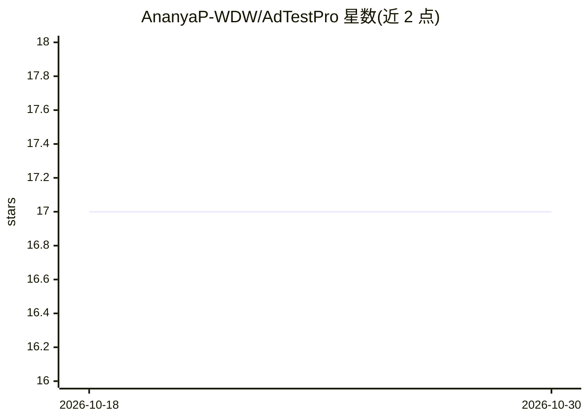

# AnanyaP-WDW/AdTestPro

⭐ 17 · Python · NOASSERTION · 推送 2026-10-23 · [GitHub](https://github.com/AnanyaP-WDW/AdTestPro) · [官网](https://ananyapathak.xyz/) · 个人维护

**用 AI 合成焦点小组在数分钟内预检广告创意**

基于 FastAPI 的自托管 Web 应用：上传广告创意（PNG/JPEG），构建最多 25 个由用户提供的受众特征生成的 AI 回答者角色，LLM 产出有证据引用的结构化评估——维度评分（1-5 分量表）、分歧标记与推荐；数值计算由 Python 完成而非模型。支持 OpenAI/OpenRouter 等自有 provider key，可选模型池轮换以分散单一厂商偏好。每次运行记录模型 ID、token 用量等回执，历史存于本地 SQLite。定位为实验性筛选信号，不替代人类研究；单用户假设，无多用户隔离。GPLv3 或商业双许可。

## 筛选速览

| 维度 | 判定 | 备注 |
|---|---|---|
| AI 角色 | `ai-native` | 本体是模型或模型工具 |
| 许可风险 | `none` | NOASSERTION |
| 部署形态 | `self-host` | docker 或自建部署 |
| 模型依赖 | — | README 未给出锁定关系 |
| 硬件要求 | — | 无带数字的原话,不猜 |
| 安装摩擦 | `low` | 无编译、无系统依赖或容器化 |
| 成熟度 | `idea` | |

## 能力要点

- 最多 25 个 AI 回答者的覆盖面板，事实区分为 supplied/hypothesis
- 1–5 分量表评分含分歧标记，模型只解释数值、不生成最终分数
- 每次运行记录模型 ID、prompt 哈希、token 用量的完整回执，缓存重放位级确定性
- 自托管 provider key 管理，支持 OpenAI/OpenRouter 及自定义 Base URL

## 适用场景

- 广告创意投放前快速做合成受众焦点小组测试
- 以 API 形式批量获取带证据引用的广告评估报告
- 在小预算下获取创意筛选参考信号（约 $0.05-0.15/次）

## 场景标签

`科研工具` · 领域:学习与行业

## 证据(README 行号)

> L11:  Upload an ad. Get a coverage panel of up to 25 AI respondents (default 12),
> L39: AdTestPro sits between: a **bounded, auditable pipeline** where LLMs produce
> L47: |**Coverage panel, not fake people**|Up to 25 personas (default 12) spanning your pain points, interests, familiari

## 星数曲线

2026-10-18 17 → 2026-10-30 17（+0）

---
*卡片 v1 · prompt 1.4 · 生成 2026-10-30 · 置信度 high · 依据 README sha `be142bd1799c` · [字段定义](../../DATASET.md)*
