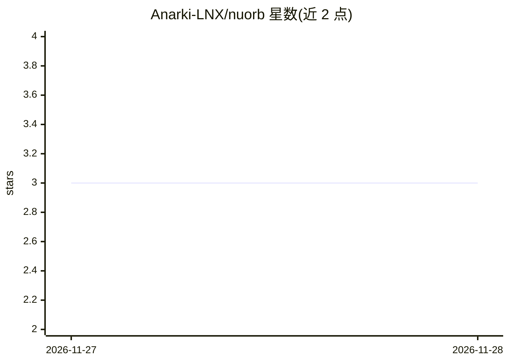

# Anarki-LNX/nuorb

⭐ 3 · Python · NOASSERTION · 推送 2026-11-27 · [GitHub](https://github.com/Anarki-LNX/nuorb) · [官网](https://anarki-lnx.github.io/nuorb/) · 个人维护

**自托管私有 AI 语音助手：Docker 服务器 + Android 应用**

以单个 Docker 容器自托管的语音助手服务器，配套 Android 应用或浏览器访问：语音对话（端点检测）、本地语音识别（Parakeet-TDT v3）与合成（Piper）、Hermes Agent、带动画球体的 Web UI 与管理面板（模型回退、人格、记忆、技能、MCP 服务器、备份）。LLM 可选本地 Ollama（≥64k 上下文）或 Anthropic Claude API，按 local/auto/remote 切换。音频在自有服务器处理，仅选用云模型时发送文本。安装需 Docker Compose v2、约 4 GB 内存。

## 筛选速览

| 维度 | 判定 | 备注 |
|---|---|---|
| AI 角色 | `ai-native` | 本体是模型或模型工具 |
| 许可风险 | `none` | NOASSERTION |
| 部署形态 | `self-host` | docker 或自建部署 |
| 模型依赖 | local-ok | 支持本地模型 |
| 硬件要求 | — | 无带数字的原话,不猜 |
| 安装摩擦 | `low` | 无编译、无系统依赖或容器化 |
| 成熟度 | `idea` | |

## 能力要点

- 本地/自动/远程三档大脑切换：Ollama 优先，Claude 可选回退
- 本地 STT（Parakeet-TDT v3，CPU）与本地 TTS（Piper）
- 危险操作前显示确认卡片，配对采用证书固定，无遥测
- 管理面板支持 MCP 服务器接入（如 Home Assistant）

## 适用场景

- 在家用网络搭建不外发音频的私有语音助手
- 手机语音控制家中设备并逐项确认执行
- 用旧手机改造为带唤醒词的语音终端

## 场景标签

`语音 Agent` `AI 助手` · 领域:对话与助手

## 证据(README 行号)

> L10: The NuOrb server is open source. It runs a complete voice assistant on your own hardware: an agent (Hermes Agent),
> L12: The "brain" is your own Ollama (e.g. a gaming PC), the Claude API, or both with a switch.

## 星数曲线

2026-11-27 3 → 2026-11-28 3（+0）

---
*卡片 v1 · prompt 1.4 · 生成 2026-11-27 · 置信度 high · 依据 README sha `5f81879383f0` · [字段定义](../../DATASET.md)*
