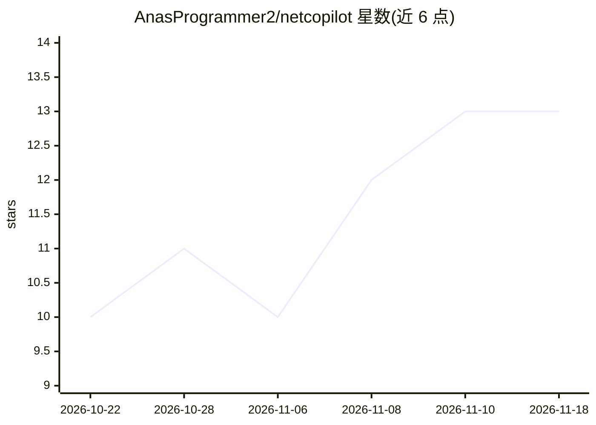

# AnasProgrammer2/netcopilot

⭐ 13 · TypeScript · NOASSERTION · 推送 2026-10-21 · [GitHub](https://github.com/AnasProgrammer2/netcopilot) · [官网](https://netcopilot.app) · 个人维护

**给网络工程师的 AI SSH 客户端，ARIA 只读诊断网络故障**

基于 Electron 的桌面 SSH/Telnet/Serial 客户端，面向网络工程师，提供会话管理、SFTP、端口转发、跳板机、加密凭据库与配置导入等功能。内置 ARIA agent：读取会话输出，按厂商 playbook 运行只读诊断命令，给出根因解释与变更计划；任何变更需人工批准，并通过设备自身回滚机制（commit confirmed、reload in、checkpoint 等）提供回退路径。支持 Investigate/Change/Autopilot 三种模式与生产/测试/实验室分级策略。AI 后端可选 Claude、OpenAI、Grok API key 或本地 OpenAI 兼容服务；提供 macOS/Windows/Linux 安装包，也可从源码构建。

## 筛选速览

| 维度 | 判定 | 备注 |
|---|---|---|
| AI 角色 | `ai-enhanced` | 去掉 AI 部分产品仍成立 |
| 许可风险 | `none` | NOASSERTION |
| 部署形态 | `library` | 以包/库形式分发 |
| 模型依赖 | local-ok | 支持本地模型 |
| 硬件要求 | — | 无带数字的原话,不猜 |
| 安装摩擦 | `low` | 无编译、无系统依赖或容器化 |
| 成熟度 | — | 结构信号不足 |

## 能力要点

- ARIA agent 按厂商 playbook 运行只读诊断命令并给出变更计划
- 变更需人工批准，配合 Junos commit confirmed、Cisco reload in、NX-OS checkpoint 等设备侧回滚机制
- 支持 Anthropic/OpenAI/xAI API key 或任意 OpenAI 兼容本地服务（Ollama、LM Studio、vLLM、LocalAI）
- 跨平台桌面应用：macOS（签名公证）、Windows 安装包/便携版、Linux AppImage/.deb

## 适用场景

- 排查 BGP/OSPF/防火墙等网络故障并获得根因解释
- NOC 团队做一线标准化诊断
- 管理多厂商设备的日常 SSH 会话与配置变更
- 内网环境下用本地模型做离线诊断

## 场景标签

`AI 助手` · 领域:对话与助手

## 证据(README 行号)

> L28: - **A complete, free SSH client.** Sessions, SFTP, port forwarding, jump hosts, serial consoles, snippets and an en
> L31: - **Private by default.** Everything is encrypted on your machine. Bring your own Claude, OpenAI or Grok key — or r
> L175: - **Network engineers** working with Cisco, Juniper, Arista, Palo Alto, Fortinet and MikroTik every day

## 星数曲线

2026-10-22 10 → 2026-11-18 13（+3）

---
*卡片 v1 · prompt 1.4 · 生成 2026-11-18 · 置信度 high · 依据 README sha `fcd6e059d24a` · [字段定义](../../DATASET.md)*
