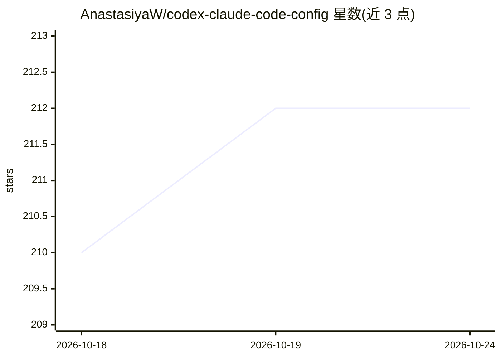

# AnastasiyaW/codex-claude-code-config

⭐ 212 · Python · MIT · 推送 2026-10-24 · [GitHub](https://github.com/AnastasiyaW/codex-claude-code-config) · 个人维护

**面向 Claude Code/Codex 等 coding agent 的配置体系：原则、钩子、技能与工作流**

一套可拆用的工作配置包，覆盖架构原则、强制执行钩子、技能、规则模板与工作流命令，供 Claude Code、Codex 及多 agent 场景的项目直接嵌入。机制包括：PreToolUse 钩子拦截破坏性命令与密钥泄露、SessionStart 校验文件引用、多会话锁文件协调、agent 间文件邮箱、供应链防御（封锁 7 天内新包）、六层 prompt injection 防御等。提供三种安装路径：Claude Code 插件安装、全局 git clone 安装、项目本地安装，并按项目类型给出最小安装组合表。附带事故复盘文档，区分测量事实与推断。

## 筛选速览

| 维度 | 判定 | 备注 |
|---|---|---|
| AI 角色 | `ai-ecosystem` | LLM/agent 周边工具 |
| 许可风险 | `permissive` | MIT |
| 部署形态 | `self-host` | docker 或自建部署 |
| 模型依赖 | locked-api |  |
| 硬件要求 | — | 无带数字的原话,不猜 |
| 安装摩擦 | `low` | 无编译、无系统依赖或容器化 |
| 成熟度 | — | 结构信号不足 |

## 能力要点

- 按项目类型给出原则/钩子/技能的最小安装组合表
- PreToolUse 钩子机械执行规则：拦截破坏性命令、密钥泄露、未闭环 handoff
- 多 agent 与多会话协调：锁文件、append-only handoff、文件邮箱
- 供应链与安全防御：封锁 7 天内新发布包、六层 prompt injection 防御

## 适用场景

- 为 Claude Code/Codex 项目配置安全钩子与工作原则
- 多 agent 或多会话并行开发时协调状态与交接
- 希望 agent 基于已验证模式工作而非每次重新摸索

## 场景标签

`提示工程` `多智能体` · 领域:Agent 开发

## 证据(README 行号)

> L5: A practical configuration kit for Claude Code, Codex, and other coding agents. It contains architectural principles,
> L7: This is not a collection of tips. It is a **system** that teaches your agent *how to work* - when to use one agent v
> L129: **Ready-to-use hooks** that enforce rules mechanically, not probabilistically (install via scripts/install_hooks.p

## 星数曲线

2026-10-18 210 → 2026-10-24 212（+2）

---
*卡片 v1 · prompt 1.4 · 生成 2026-10-22 · 置信度 mid · 依据 README sha `d6f38947b16c` · [字段定义](../../DATASET.md)*
