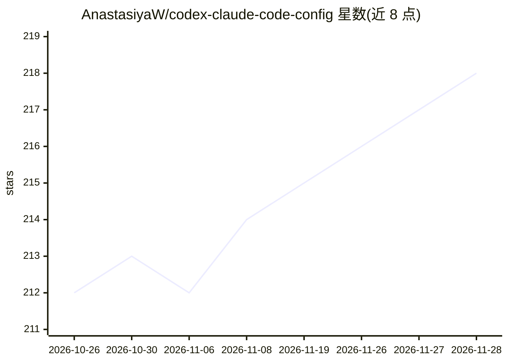

# AnastasiyaW/codex-claude-code-config

⭐ 218 · Python · MIT · 推送 2026-11-27 · [GitHub](https://github.com/AnastasiyaW/codex-claude-code-config) · 个人维护

**给使用 Claude Code/Codex 的开发者的 agent 配置系统**

一套面向 Claude Code 与 Codex 等编码 agent 的配置套件，包含架构原则、enforcement hooks、skills、drop-in 规则、模板与动态工作流命令，按项目类型给出最小安装组合。配置源自真实事故记录，每条写明测量值、推断与未覆盖范围；机制包括 Generator/Evaluator 分离、proof artifacts、多 agent 分解、供应链与 prompt injection 防护 hook、50 分钟等待上限与 1 小时 prompt cache 设置。支持插件市场、全局安装、项目本地三种安装路径。

## 筛选速览

| 维度 | 判定 | 备注 |
|---|---|---|
| AI 角色 | `ai-ecosystem` | LLM/agent 周边工具 |
| 许可风险 | `permissive` | MIT |
| 部署形态 | `self-host` | docker 或自建部署 |
| 模型依赖 | — | README 未给出锁定关系 |
| 硬件要求 | — | 无带数字的原话,不猜 |
| 安装摩擦 | `low` | 无编译、无系统依赖或容器化 |
| 成熟度 | — | 结构信号不足 |

## 能力要点

- 五种安全 hook：破坏性命令、密钥泄漏、git 破坏性操作、自动备份、会话漂移校验
- Generator/Evaluator 分离与 durable proof artifacts 的 proof loop 机制
- 供应链防护（拦截发布不足 7 天的包）与六层 prompt injection 防护
- 按项目类型（Web/ML/多 agent/库）给出最小安装组合表

## 适用场景

- 为团队项目配置统一的 Claude Code/Codex 安全 hooks 与规则
- 让 coding agent 从已验证的工作模式起步而非每次重新摸索
- 多 agent 并行会话时的协调与通信原则配置
- 防范供应链攻击与 repo/MCP/web 的 prompt 注入

## 场景标签

`编码 Agent` `提示工程` `多智能体` · 领域:Agent 开发

## 证据(README 行号)

> L5: A practical configuration kit for Claude Code, Codex, and other coding agents. It contains architectural principles,
> L7: This is not a collection of tips. It is a **system** that teaches your agent *how to work* - when to use one agent v
> L34: ## Installation

## 星数曲线

2026-10-26 212 → 2026-11-28 218（+6）

---
*卡片 v1 · prompt 1.4 · 生成 2026-11-26 · 置信度 mid · 依据 README sha `921874e8a54b` · [字段定义](../../DATASET.md)*
