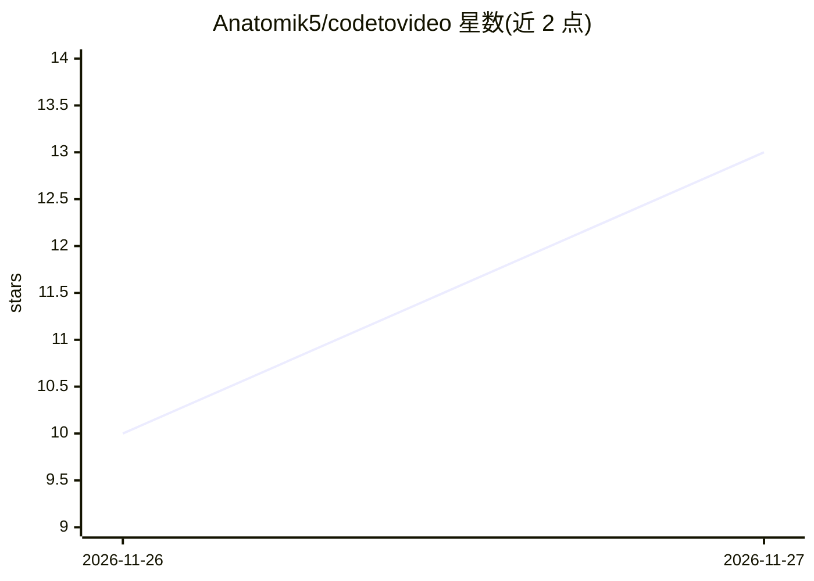

# Anatomik5/codetovideo

⭐ 13 · TypeScript · MIT · 推送 2026-11-26 · [GitHub](https://github.com/Anatomik5/codetovideo) · 个人维护

**给开发者一句话生成 Web 应用演示/宣传视频的本地工具**

CTV 面向想为自己的 Web 应用制作演示或宣传视频的开发者：LLM 读取仓库并生成场景计划（标题、字幕、节奏、配色），Playwright 驱动浏览器真实录制应用操作，FFmpeg 与 Remotion 本地合成 mp4，画面不依赖生成式视频模型因此不会虚构界面。提供 Electron 桌面应用与 CLI 两种入口，支持 demo/promo 两种格式、480p–4K 分辨率、非破坏性场景编辑与 srt 字幕导出。限制：仅 alpha 状态、仅支持 Web UI、无音频、CPU 渲染较慢。

## 筛选速览

| 维度 | 判定 | 备注 |
|---|---|---|
| AI 角色 | `ai-enhanced` | 去掉 AI 部分产品仍成立 |
| 许可风险 | `permissive` | MIT |
| 部署形态 | `library` | 以包/库形式分发 |
| 模型依赖 | local-ok | 支持本地模型 |
| 硬件要求 | — | 无带数字的原话,不猜 |
| 安装摩擦 | `medium` | 含编译或系统依赖之一 |
| 成熟度 | `idea` | |

## 能力要点

- LLM 编排 + Playwright 真实录制，界面内容不会幻觉
- 支持任意 OpenAI 兼容 API 的 LLM，含本地 Ollama 路线
- 完全本地运行，无遥测、无云端调用（本地模型时）
- 非破坏性场景编辑：改字幕或单场景重拍，其余剪辑不动

## 适用场景

- 为自己的开源项目快速生成 demo 视频
- 给内部/私有应用离线制作演示视频
- 一句话生成产品宣传片并手动微调单个场景

## 场景标签

`视频生成` · 领域:内容生成

## 证据(README 行号)

> L5: **Point it at any web app, write one sentence, get a demo or promo video. The AI directs; a real program records. Fr
> L29: - Everything you see on screen is a **real recording of your real app**, driven by Playwright through ordinary DOM 
> L30: - FFmpeg and Remotion assemble the result: deterministic, local, free.

## 星数曲线

2026-11-26 10 → 2026-11-27 13（+3）

---
*卡片 v1 · prompt 1.4 · 生成 2026-11-26 · 置信度 high · 依据 README sha `273a130f0fa0` · [字段定义](../../DATASET.md)*
