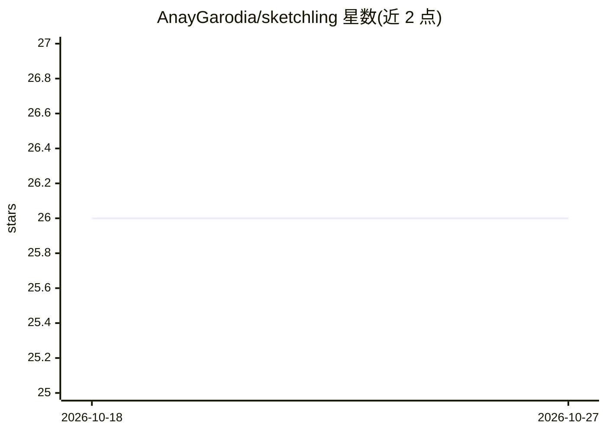

# AnayGarodia/sketchling

⭐ 26 · TypeScript · MIT · 推送 2026-08-16 · [GitHub](https://github.com/AnayGarodia/sketchling) · 个人维护

**供 LLM/编码代理使用的手绘插画与动画语言**

面向 LLM 与编码代理的 TypeScript 手绘插画与动画词汇表：代理读写该词汇表生成场景代码，经 Node 构建场景图后在无头 Chromium 中由 rough.js 绘制 SVG、GSAP 驱动时间线，支持确定性渲染与视频导出。提供手绘原语、drawOn 手绘式揭示动画、IK 肢体与步态、摄影机、粒子与合成音效，含 5 种 look 与 3 种 texture。AGENTS.md 作为代理参考文档并自动装入 .claude/.agents skills 目录。渲染依赖 Playwright Chromium，视频导出需 ffmpeg。作者自述项目处于早期且设计上有意取窄。

## 筛选速览

| 维度 | 判定 | 备注 |
|---|---|---|
| AI 角色 | `ai-ecosystem` | LLM/agent 周边工具 |
| 许可风险 | `permissive` | MIT |
| 部署形态 | `library` | 以包/库形式分发 |
| 模型依赖 | — | README 未给出锁定关系 |
| 硬件要求 | — | 无带数字的原话,不猜 |
| 安装摩擦 | `medium` | 含编译或系统依赖之一 |
| 成熟度 | `idea` | |

## 能力要点

- 面向代理的词汇表：原语带 weight/looseness/energy 等性格参数而非纯几何 API
- 确定性渲染：同场景同时间戳输出字节级一致，可用 cmp 校验
- IK 肢体、程序化双足步态、标签化相对时间调度与多场景剪辑
- AGENTS.md 全量参考并作为 Claude/agents skills 自动加载

## 适用场景

- 让编码代理根据一句提示生成手绘短片并自动渲染导出
- 为 LLM 输出的插画/动画提供宽容的手绘风格表达方式
- 在浏览器 Playground 中编写场景并分享渲染链接

## 场景标签

`图像生成` `视频生成` · 领域:内容生成

## 证据(README 行号)

> L7: A hand drawn illustration and animation language for LLMs. Manim gave language models a way to express math visually
> L13: Nobody hand animated this. Devin built it cold, working from nothing but this repository's own docs, the same way e
> L79: Every film in this README, including *The Lantern Maker* at the top, was built by handing an agent a prompt like th

## 星数曲线

2026-10-18 26 → 2026-10-27 26（+0）

---
*卡片 v1 · prompt 1.4 · 生成 2026-10-26 · 置信度 high · 依据 README sha `9b203885e053` · [字段定义](../../DATASET.md)*
