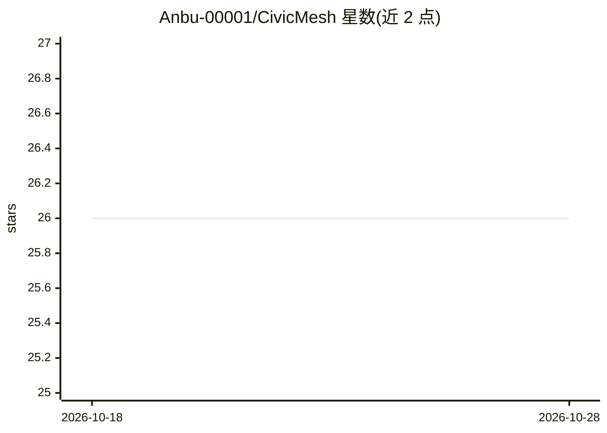

# Anbu-00001/CivicMesh

⭐ 26 · Jac · MIT · 推送 2026-10-28 · [GitHub](https://github.com/Anbu-00001/CivicMesh) · [官网](https://huggingface.co/spaces/Anbu-00001/CivicMesh) · 个人维护

**面向危机人群的社会救助资格导航应用：住房/食品/医疗/法律援助匹配**

用 Jac 图规则引擎（7 个 walker）按 2026 年美国联邦规则对用户一句话描述做资格判定，输出排序、可解释的行动计划、真实本地办事处电话与图可视化决策流；判定在约 1 毫秒内闭式计算完成，LLM 仅在答案呈现后做摘要与补充语言翻译。支持 51 种语言（机器起草、0/50 经母语者审校）、无注册、用户输入不存储也不发送给模型。限制：资格分数为手工设权重的打分而非校准概率，未经真实个案工作者监督试点验证；构建于 pre-1.0 的 Jac 语言，引擎经转译为纯 Python 维护。

## 筛选速览

| 维度 | 判定 | 备注 |
|---|---|---|
| AI 角色 | `ai-enhanced` | 去掉 AI 部分产品仍成立 |
| 许可风险 | `permissive` | MIT |
| 部署形态 | `self-host` | docker 或自建部署 |
| 模型依赖 | — | README 未给出锁定关系 |
| 硬件要求 | — | 无带数字的原话,不猜 |
| 安装摩擦 | `low` | 无编译、无系统依赖或容器化 |
| 成熟度 | — | 结构信号不足 |

## 能力要点

- 7 个 Jac walker 以闭式规则计算资格判定，决策路径不依赖 LLM
- 40 个真实项目/办事处数据，引用 2026 HHS/HUD 等规则来源
- 51 种语言回答（75 种语言路径无 LLM），NVIDIA Riva Translate/Gemma 补充翻译
- 危机标记硬编码路由、Quick exit 与不存储用户输入的隐私设计

## 适用场景

- 危机中的人用母语一句话描述处境，获得符合条件的项目与电话
- 个案工作者核验某家庭对住房/食品/医疗/法律援助的资格
- 查看每个资格判定背后的可解释决策子图

## 场景标签

 · 领域:公共服务/社会救助

## 证据(README 行号)

> L11: ### A rules engine on a graph that routes people in crisis to the housing, food, healthcare and legal aid they qual
> L37: **Math first, LLM last.** Every decision a caseworker would have to defend — who qualifies, why, what to do first —
> L41: |**Answers in 51 languages (machine-drafted, none reviewed yet); 111 selectable**|The whole answer — programs, next

## 星数曲线

2026-10-18 26 → 2026-10-28 26（+0）

---
*卡片 v1 · prompt 1.4 · 生成 2026-10-26 · 置信度 mid · 依据 README sha `4ec527242828` · [字段定义](../../DATASET.md)*
