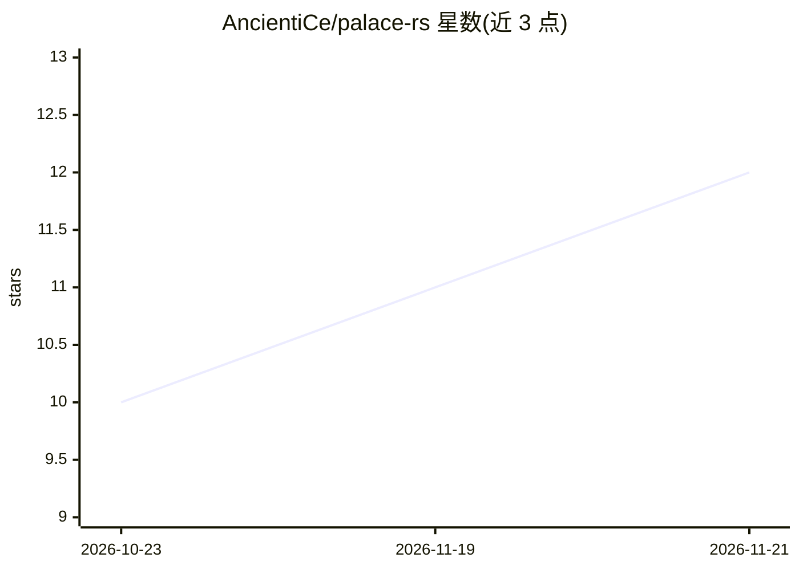

# AncientiCe/palace-rs

⭐ 12 · Rust · MIT · 推送 2026-11-20 · [GitHub](https://github.com/AncientiCe/palace-rs) · 个人维护

**给编码 agent 提供本地跨会话记忆的 MCP 服务器**

一个本地优先的 MCP 记忆服务器：以单个 SQLite 文件存储代码、笔记与对话原文，用本地 ONNX Runtime 上的 all-MiniLM-L6-v2 生成嵌入，无需 API key 与云服务。通过 BM25 与余弦相似度混合检索、意图分类加权重排序，并返回来源引用。经 palace install 为 Claude Code、Codex、Cursor 等客户端注册 hooks，在会话开始、提交提示、工具调用后自动注入相关记忆，会话结束前提示写入日记。非软件项目可用 creative/personal 配置。macOS Intel 平台不支持。

## 筛选速览

| 维度 | 判定 | 备注 |
|---|---|---|
| AI 角色 | `ai-ecosystem` | LLM/agent 周边工具 |
| 许可风险 | `permissive` | MIT |
| 部署形态 | `None` |  |
| 模型依赖 | — | README 未给出锁定关系 |
| 硬件要求 | — | 无带数字的原话,不猜 |
| 安装摩擦 | `medium` | 含编译或系统依赖之一 |
| 成熟度 | — | 结构信号不足 |

## 能力要点

- 单二进制 + 单 SQLite 文件，嵌入在本地 CPU 上运行，无 API key
- BM25 与向量余弦混合检索，含意图分类与可选本地 cross-encoder 重排
- 用户级 hooks 自动注入记忆：会话开始、提示提交、工具调用后、停止时写日记
- 嵌入模型可迁移：批量构建新向量并用 recall@1/@5 与延迟探针验证后切换

## 适用场景

- 让编码 agent 记住项目决策、修复记录与命令偏好，跨会话延续上下文
- 多个 agent（如 Claude Code 与 Codex）共享同一份项目记忆
- 在离线/本地环境下为 agent 提供带来源引用的记忆检索
- 用 creative/personal 配置管理世界观设定、小说或个人笔记

## 场景标签

`Agent 记忆` · 领域:Agent 开发

## 证据(README 行号)

> L12:  Local-first memory for coding agents.
> L14:  One binary, one SQLite file, no API keys, no cloud.
> L54: - **Recalling without being asked.** Hooks inject relevant memory when a
> L68: Pick one. Each method installs the `palace` binary. Run `palace install`

## 星数曲线

2026-10-23 10 → 2026-11-21 12（+2）

---
*卡片 v1 · prompt 1.4 · 生成 2026-11-19 · 置信度 high · 依据 README sha `612ddb18578e` · [字段定义](../../DATASET.md)*
