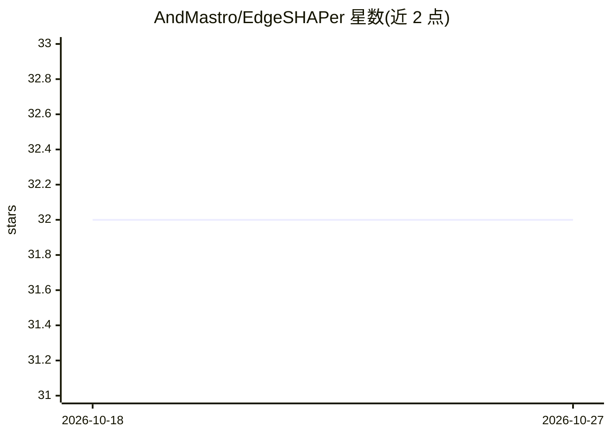

# AndMastro/EdgeSHAPer

⭐ 32 · Jupyter Notebook · GPL-3.0 · 推送 2026-10-13 · [GitHub](https://github.com/AndMastro/EdgeSHAPer) · 组织维护

**GNN 边级 Shapley 值解释方法，用于药物化学图分类模型**

EdgeSHAPer 的官方 PyTorch 实现：通过 Monte Carlo 采样近似 Shapley 值，计算图中每条边对 GNN 预测的贡献，面向药物化学场景但可用于任何需要可解释性的图分类 GNN。提供 edgeshaper() 函数与 Edgeshaper 类两种用法，类接口支持 Pertinent Positive Set/Infidelity、Minimal Top-K/Fidelity 指标及分子结构可视化；另有并行实现 explain_batch() 可批量解释分子。依赖 PyTorch 与 PyTorch Geometric（测试环境 Python 3.8/PyTorch 1.10/CUDA 10.2），提供 conda 配置文件与论文实验复现代码。当前仅支持图分类，节点分类扩展为规划中。

## 筛选速览

| 维度 | 判定 | 备注 |
|---|---|---|
| AI 角色 | `ai-ecosystem` | LLM/agent 周边工具 |
| 许可风险 | `viral` | GPL-3.0 |
| 部署形态 | `None` |  |
| 模型依赖 | — | README 未给出锁定关系 |
| 硬件要求 | — | 无带数字的原话,不猜 |
| 安装摩擦 | `medium` | 含编译或系统依赖之一 |
| 成熟度 | — | 结构信号不足 |

## 能力要点

- 基于 Monte Carlo 采样近似 Shapley 值计算边重要性
- Edgeshaper 类提供 Infidelity/Fidelity 指标与最小信息集计算
- 解释可映射到分子结构并可视化（红/蓝边表正/负贡献）
- explain_batch() 并行实现，批量解释与单分子耗时相同

## 适用场景

- 解释我的图分类 GNN 中哪些化学键驱动了预测
- 药物化学中定位活性化合物的关键子结构
- 复现论文中的可解释性实验

## 场景标签

`科研工具` · 领域:学习与行业

## 证据(README 行号)

> L9: The methodology relies on Shapley values approximations to determine edge importance for GNN prediction. It finds it
> L12: EdgeSHAPer relies on PyTorch. It was tested with Python 3.8, PyTorch 1.10, CUDA 10.2 and PyTorch Geometric 2.0. We 

## 星数曲线

2026-10-18 32 → 2026-10-27 32（+0）

---
*卡片 v1 · prompt 1.4 · 生成 2026-10-26 · 置信度 high · 依据 README sha `3ea71303570a` · [字段定义](../../DATASET.md)*
