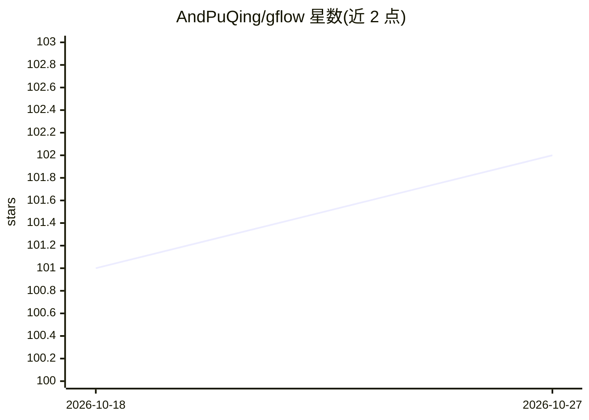

# AndPuQing/gflow

⭐ 102 · Rust · MIT · 推送 2026-10-25 · [GitHub](https://github.com/AndPuQing/gflow) · [官网](https://runqd.com) · 个人维护 · 中文 README

**单机 GPU 作业调度器：给共享工作站带来类 Slurm 工作流**

Rust 实现的轻量级单 Linux 机器作业调度器，面向共享 GPU 工作站与实验室服务器，无需集群部署即可获得类 Slurm 工作流。支持提交带 GPU、时间限制、依赖、数组与优先级的命令或脚本，通过小 CLI 查看、附加、取消与恢复作业。依赖仅需 Linux 与 tmux（GPU 调度时需 NVIDIA 驱动），可经 pip/pipx/uv 或 cargo 安装，支持 systemd 用户服务自启动；另可作为本地 MCP 服务器供 Claude Desktop、Claude Code、Codex、Cursor 等工具调用。

## 筛选速览

| 维度 | 判定 | 备注 |
|---|---|---|
| AI 角色 | `ai-ecosystem` | LLM/agent 周边工具 |
| 许可风险 | `permissive` | MIT |
| 部署形态 | `library` | 以包/库形式分发 |
| 模型依赖 | — | README 未给出锁定关系 |
| 硬件要求 | — | 无带数字的原话,不猜 |
| 安装摩擦 | `medium` | 含编译或系统依赖之一 |
| 成熟度 | — | 结构信号不足 |

## 能力要点

- 单机队列调度：GPU、时间限制、依赖、数组、优先级
- 小型 CLI（gbatch/gqueue/gjob）管理作业，支持崩溃恢复
- 可运行本地 MCP 服务器，接入 Claude Desktop/Claude Code/Codex/Cursor
- pip/pipx/uv 与 cargo 双通道安装，systemd 用户服务托管守护进程

## 适用场景

- 实验室共享 GPU 服务器上排队跑深度学习训练任务
- 无集群运维成本地获得类 Slurm 的提交/依赖/优先级工作流
- 让 Claude/Codex 等 AI 工具通过 MCP 直接提交和查询作业

## 场景标签

 · 领域:HPC/GPU 作业调度

## 证据(README 行号)

> L16: `gflow` is a lightweight scheduler for a single Linux machine. It brings a Slurm-like workflow to shared GPU workst
> L69: `gflow` can also run as a local MCP server for Claude Desktop, Claude Code, Codex, Cursor, and similar tools:

## 星数曲线

2026-10-18 101 → 2026-10-27 102（+1）

---
*卡片 v1 · prompt 1.4 · 生成 2026-10-23 · 置信度 mid · 依据 README sha `70906c0c9e94` · [字段定义](../../DATASET.md)*
