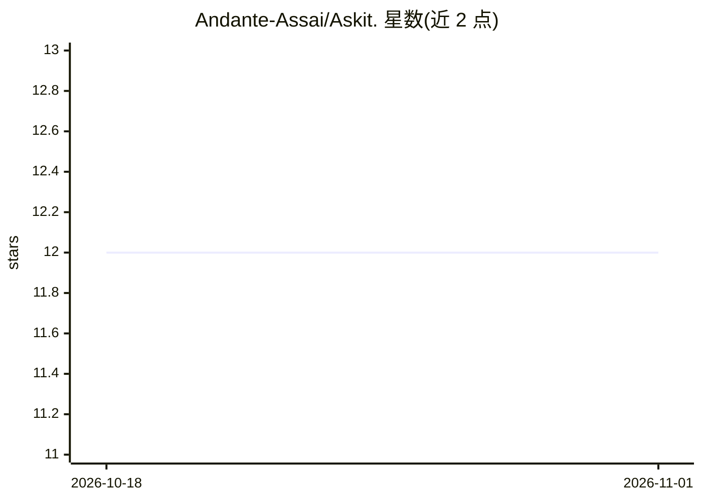

# Andante-Assai/Askit.

⭐ 12 · Python · GPL-3.0 · 推送 2026-08-18 · [GitHub](https://github.com/Andante-Assai/Askit.) · 个人维护 · 中文 README

**AI 驱动的交互式数学/物理动画教学软件**

Askit 是一款面向学习与教学场景的交互式数学动画软件：内置基于 OLMo-thinking 架构的微调模型（托管于 HuggingFace），提供空间理解、物理建模（可调用 PhysicsBridge API）与竞赛级（CPhO/IMO）问题优化能力；用户也可通过配置 API（如 OpenRouter 接入 Claude 模型）使用。软件含 C++ 物理引擎（刚体碰撞、SPH 流体、ODE/PDE 求解器）、逐帧快照记录、OpenGL 实时渲染、时间线与交互控件。限制：README 未给出安装命令，微调模型云服务尚未部署。

## 筛选速览

| 维度 | 判定 | 备注 |
|---|---|---|
| AI 角色 | `ai-native` | 本体是模型或模型工具 |
| 许可风险 | `viral` | GPL-3.0 |
| 部署形态 | `None` |  |
| 模型依赖 | — | README 未给出锁定关系 |
| 硬件要求 | — | 无带数字的原话,不猜 |
| 安装摩擦 | `low` | 无编译、无系统依赖或容器化 |
| 成熟度 | `idea` | |

## 能力要点

- 基于 OLMo-thinking 架构、针对物理/数学问题微调的专属模型
- C++ 物理引擎：刚体碰撞、SPH 流体、Euler/RK4/RK45 等 ODE/PDE 求解器
- 逐帧快照让 AI 读取并理解动画场景状态
- OpenGL 实时渲染、时间线控制与滑块/按钮等交互控件

## 适用场景

- 竞赛级（CPhO/IMO）物理与数学问题的可视化讲解
- 课堂教学中生成高质量交互式动画演示
- 通过交互控件实时调参观察物理过程变化
- 需要精确物理建模的科研模拟展示

## 场景标签

 · 领域:教育/数理可视化

## 证据(README 行号)

> L5: ### 🚀 AI-Powered Interactive Math Animation Teaching Software
> L19: Welcome to Askit. - AI-Powered Interactive Math Animation Teaching Software!
> L29: The **fine-tuned model** is an AI model custom-optimized for Askit., built on the OLMo-thinking architecture. Train

## 星数曲线

2026-10-18 12 → 2026-11-01 12（+0）

---
*卡片 v1 · prompt 1.4 · 生成 2026-11-01 · 置信度 mid · 依据 README sha `2d44e5fdf02a` · [字段定义](../../DATASET.md)*
