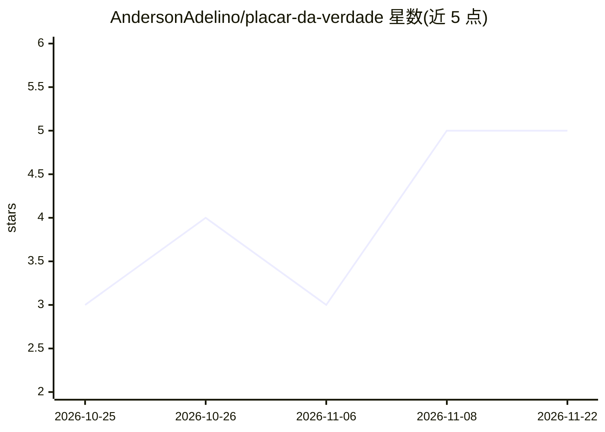

# AndersonAdelino/placar-da-verdade

⭐ 5 · JavaScript · AGPL-3.0 · 推送 2026-10-28 · [GitHub](https://github.com/AndersonAdelino/placar-da-verdade) · [官网](https://placardaverdade.com.br) · 个人维护

**实时核查政治辩论事实并公开计分的机器人**

面向政治辩论的实时事实核查机器人：将辩论音频切成 10 秒片段，本地语音识别标注说话人，LLM 区分可核查事实与观点/承诺/攻击，联网检索辩论当时已有的信息，由裁判模型给出 verdadeiro/impreciso/falso/sem_dados 判定，发布前由其他模型复核音频片段。所有模型经 OpenRouter 调用，支持 --limite 控制花费上限，站点为托管在 Cloudflare 的静态页。需 Node.js 22+、ffmpeg、yt-dlp 与 OpenRouter key。

## 筛选速览

| 维度 | 判定 | 备注 |
|---|---|---|
| AI 角色 | `ai-native` | 本体是模型或模型工具 |
| 许可风险 | `viral` | AGPL-3.0 |
| 部署形态 | `library` | 以包/库形式分发 |
| 模型依赖 | locked-api |  |
| 硬件要求 | — | 无带数字的原话,不猜 |
| 安装摩擦 | `medium` | 含编译或系统依赖之一 |
| 成熟度 | — | 结构信号不足 |

## 能力要点

- 多模型流水线：转写、事实抽取、检索、裁决、复核均经 OpenRouter
- 本地语音识别（约 30 MB 模型）标注发言人，无注册时可用按键手动标注
- 检索限定辩论时点之前的信息，录制视频可作时间回放模拟
- 引用校验：无可用来源 URL 的事实进入'待审'而不公开

## 适用场景

- 选举辩论直播时逐条核查候选人陈述并展示计分板
- 复盘已录制的辩论，按当时的新闻语境做核查
- 部署自己的静态核查站点到 Cloudflare

## 场景标签

`语音识别` · 领域:感知与多模态

## 证据(README 行号)

> L3: Robô que checa, **ao vivo**, os fatos ditos pelos candidatos em um debate político e mostra o placar
> L15: 2. Uma IA transcreve e o reconhecimento de voz (local, grátis) identifica quem está falando.
> L21: Todas as IAs passam pela OpenRouter. Os modelos usados estão no topo do `robo.mjs`.

## 星数曲线

2026-10-25 3 → 2026-11-22 5（+2）

---
*卡片 v1 · prompt 1.4 · 生成 2026-11-21 · 置信度 high · 依据 README sha `1def28621f50` · [字段定义](../../DATASET.md)*
