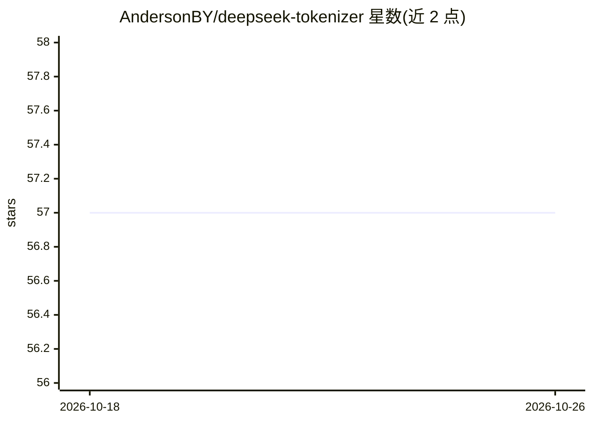

# AndersonBY/deepseek-tokenizer

⭐ 57 · Python · 推送 2026-06-28 · [GitHub](https://github.com/AndersonBY/deepseek-tokenizer) · 个人维护 · 中文 README

**轻量 DeepSeek-V4 分词库，无第三方运行时依赖**

提供 DeepSeek-V4 系列模型（DeepSeek-V4-Pro / V4-Flash）所共享的分词器的 Python 封装，内置 V4 特殊 token（thinking、DSML、quick-instruction、多模态占位符），model_max_length 为 1,048,576 tokens。库自身无第三方运行时依赖，通过 pip 安装，支持文本 encode 输出 token id 序列，并可查询特殊 token id。面向需要与 DeepSeek 模型做 token 对齐的开发者。

## 筛选速览

| 维度 | 判定 | 备注 |
|---|---|---|
| AI 角色 | `ai-ecosystem` | LLM/agent 周边工具 |
| 许可风险 | `none` | — |
| 部署形态 | `library` | 以包/库形式分发 |
| 模型依赖 | — | README 未给出锁定关系 |
| 硬件要求 | — | 无带数字的原话,不猜 |
| 安装摩擦 | `low` | 无编译、无系统依赖或容器化 |
| 成熟度 | — | 结构信号不足 |

## 能力要点

- 内置 DeepSeek-V4 系列 tokenizer 与特殊 token
- model_max_length 为 1,048,576 tokens
- 无第三方运行时依赖，pip 安装即用

## 适用场景

- 在本地对文本做与 DeepSeek-V4 模型一致的 token 计数
- 查询 V4 特殊 token 的 id 与模型最大长度
- 为调用 DeepSeek 模型的应用做输入预处理

## 场景标签

 · 领域:LLM 基础设施/分词

## 证据(README 行号)

> L7: DeepSeek Tokenizer is an efficient and lightweight tokenization library with no third-party runtime dependencies, ma
> L9: This release uses the DeepSeek-V4 series tokenizer shared by `deepseek-ai/DeepSeek-V4-Pro` and `deepseek-ai/DeepSeek

## 星数曲线

2026-10-18 57 → 2026-10-26 57（+0）

---
*卡片 v1 · prompt 1.4 · 生成 2026-10-24 · 置信度 high · 依据 README sha `233ca6756dd5` · [字段定义](../../DATASET.md)*
