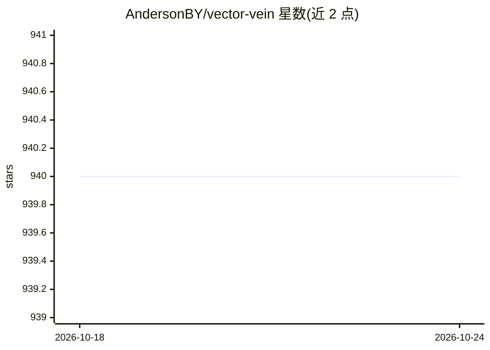

# AndersonBY/vector-vein

⭐ 940 · Vue · NOASSERTION · 推送 2026-10-20 · [GitHub](https://github.com/AndersonBY/vector-vein) · [官网](https://vectorvein.ai) · 个人维护 · 中文 README

**无代码 AI 工作流桌面软件：拖拽节点搭建自动化流程**

VectorVein 是基于 pywebview 的无代码 AI 工作流软件，用户通过拖拽节点在画布上搭建输入、处理、输出的自动化流程（翻译、总结生成思维导图、客服投诉自动分类等），结合大语言模型与个人知识库。支持 OpenAI 兼容 API 端点，可接入 Ollama/vLLM/LM-Studio 等本地服务，配置自定义 embedding 后端与 OpenAI 兼容语音识别。提供本地 FastAPI 服务供程序化调用工作流、CLI 工具，以及快捷键语音对话。桌面版从 Release 下载，需安装 webview2 运行时。

## 筛选速览

| 维度 | 判定 | 备注 |
|---|---|---|
| AI 角色 | `ai-native` | 本体是模型或模型工具 |
| 许可风险 | `none` | NOASSERTION |
| 部署形态 | `desktop` | 安装包/桌面程序 |
| 模型依赖 | local-ok | 支持本地模型 |
| 硬件要求 | — | 无带数字的原话,不猜 |
| 安装摩擦 | `low` | 无编译、无系统依赖或容器化 |
| 成熟度 | — | 结构信号不足 |

## 能力要点

- 拖拽节点编辑工作流，含官方模板与在线教程
- 支持 OpenAI 兼容端点，可接 Ollama/vLLM/LM-Studio 本地服务
- 本地 FastAPI 服务（端口 8787）程序化执行与监控工作流
- 支持多表工作簿输入、XLSX/DOCX 结构化输出与 JSON Schema 校验

## 适用场景

- 不懂编程的用户搭建文档翻译、文章总结等 AI 自动化流程
- 把英文 Word 文档总结成中文思维导图
- 按自定义关键词自动分类客服投诉并导出 Excel
- 通过本地 API 将工作流集成到其他程序中

## 场景标签

`工作流自动化` `RAG` · 领域:效率与自动化

## 证据(README 行号)

> L13: VectorVein is a no-code AI workflow software inspired by LangChain and langflow, designed to combine the powerful c
> L25: After downloading VectorVein from Release, the program will create a "data" folder in the installation directory to
> L34: Most workflows and agents in the software involve the use of AI large language models, so you should at least provi

## 星数曲线

2026-10-18 940 → 2026-10-24 940（+0）

---
*卡片 v1 · prompt 1.4 · 生成 2026-10-21 · 置信度 mid · 依据 README sha `a75ae5cc84d2` · [字段定义](../../DATASET.md)*
