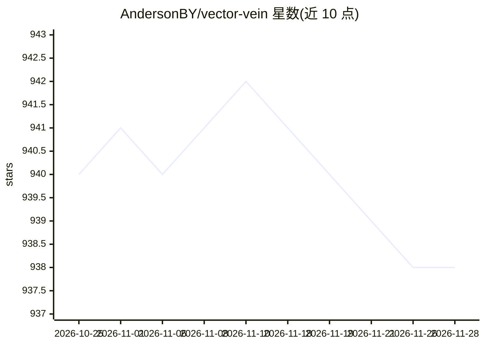

# AndersonBY/vector-vein

⭐ 938 · Python · NOASSERTION · 推送 2026-11-23 · [GitHub](https://github.com/AndersonBY/vector-vein) · [官网](https://vectorvein.ai) · 个人维护 · 中文 README

**本地桌面端 AI 工作流工具：可视化编排节点任务并供 Agent 调用**

面向日常办公的本地桌面应用，将 Task Agent 与可视化工作流整合在一个工作区内：Agent 可在项目文件夹边界内搜索、读取、写入文件并执行多步任务；可视化工作流以节点图编排固定步骤，支持多 sheet Excel 读取、JSON Schema 校验、导出 xlsx/docx/png。内置分层知识库（本地 Qdrant 向量索引+全文检索），支持 Skills、MCP 服务器接入，并可将工作流挂载为 Agent 可调用工具；提供可视化定时调度、本地 HTTP API 触发与 CLI 无头运行。许可证仅限非商业研究用途。

## 筛选速览

| 维度 | 判定 | 备注 |
|---|---|---|
| AI 角色 | `ai-native` | 本体是模型或模型工具 |
| 许可风险 | `none` | NOASSERTION |
| 部署形态 | `desktop` | 安装包/桌面程序 |
| 模型依赖 | local-ok | 支持本地模型 |
| 硬件要求 | — | 无带数字的原话,不猜 |
| 安装摩擦 | `low` | 无编译、无系统依赖或容器化 |
| 成熟度 | — | 结构信号不足 |

## 能力要点

- Task Agent 工作台：多文件夹项目内文件搜索、读写与多步执行
- 可视化工作流编辑器，支持 Excel/docx/png 导出与 JSON Schema 校验
- 分层知识库：内置本地 Qdrant 向量索引+全文检索，无需外部数据库
- Skills（SKILL.md）、MCP 服务器接入与工作流挂载为 Agent 工具

## 适用场景

- 让 Agent 读取本地项目资料并按知识库规则生成分析报告
- 把固定的数据处理步骤编排为可视化工作流做批量处理
- 配置定时任务做周期性巡检、汇总或流水线运行

## 场景标签

`工作流自动化` `AI 助手` `RAG` · 领域:效率与自动化

## 证据(README 行号)

> L7: **A local desktop application for Task Agents and visual workflows.**
> L9: Everyday work rarely lives in a single file. You often need to read across local project folders, cross-check rules 
> L70: 2. **Configure a Model**: Open **Settings** in the top-right corner, add a cloud API endpoint (OpenAI, Anthropic, D

## 星数曲线

2026-10-25 940 → 2026-11-28 938（-2）

---
*卡片 v1 · prompt 1.4 · 生成 2026-11-24 · 置信度 high · 依据 README sha `3d86ba382318` · [字段定义](../../DATASET.md)*
