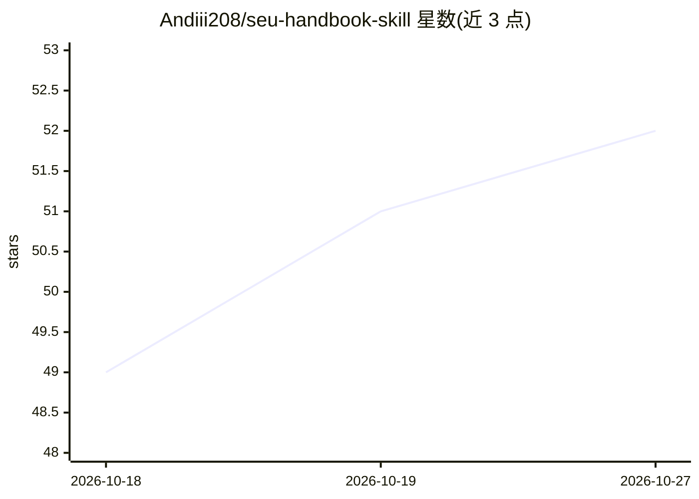

# Andiii208/seu-handbook-skill

⭐ 52 · Python · NOASSERTION · 推送 2026-10-09 · [GitHub](https://github.com/Andiii208/seu-handbook-skill) · 个人维护 · 中文 README

**东南大学学生手册的 Agent Skill 知识包：带条款引用的规章问答**

把 2025 年《东南大学大学生手册》整理为可装入本地 Agent 的 Skill：48 个校级规章全文按条拆分为 52 个文件，附教育部令第 41 号、服务指南、9 张高频数值速查表与口语词对照表；SKILL.md 定义检索路由与回答规范，回答强制附条款引用，手册未覆盖的动态信息引导至官方渠道。原 PDF 无文字层，文本经 OCR 后逐值人工核对，并以 check.py 做六项机械质检。非官方学生自发整理，内容截至 2025 年 8 月版，使用方式为克隆到 Agent 的 skills 目录。

## 筛选速览

| 维度 | 判定 | 备注 |
|---|---|---|
| AI 角色 | `ai-knowledge` | 知识聚合/清单类 |
| 许可风险 | `none` | NOASSERTION |
| 部署形态 | `None` |  |
| 模型依赖 | — | README 未给出锁定关系 |
| 硬件要求 | — | 无带数字的原话,不猜 |
| 安装摩擦 | `low` | 无编译、无系统依赖或容器化 |
| 成熟度 | — | 结构信号不足 |

## 能力要点

- 48 个校级规章全文按条拆分，头部记录页码/执行年级/解释单位可回溯
- 回答规范强制条款引用，动态信息引导官方渠道、不编造
- OCR 文本逐值人工核对，check.py 六项机械质检
- 支持同学投稿官网不公开的学院细则等材料，逐步扩展为规章百科

## 适用场景

- 本地 Agent 里直接查学校规定并得到带条款引用的回答
- 快速计算加分、判断评奖评优资格
- 查部门电话等官方渠道信息

## 场景标签

`文档问答` · 领域:知识与检索

## 证据(README 行号)

> L6: 把《东南大学大学生手册》变成一个可以装进本地 Agent 的 Skill：不用翻书、不用问同学，直接问 Agent"这事按规定怎么办"，答案带**条款引用**。
> L9: - 覆盖范围：48 个校级规章全文 +《普通高等学校学生管理规定》（教育部令第 41 号）+ 服务指南（部门电话/网址）+ 9 张高频数值速查表 + 口语词对照表

## 星数曲线

2026-10-18 49 → 2026-10-27 52（+3）

---
*卡片 v1 · prompt 1.4 · 生成 2026-10-24 · 置信度 high · 依据 README sha `7033cfeadaac` · [字段定义](../../DATASET.md)*
