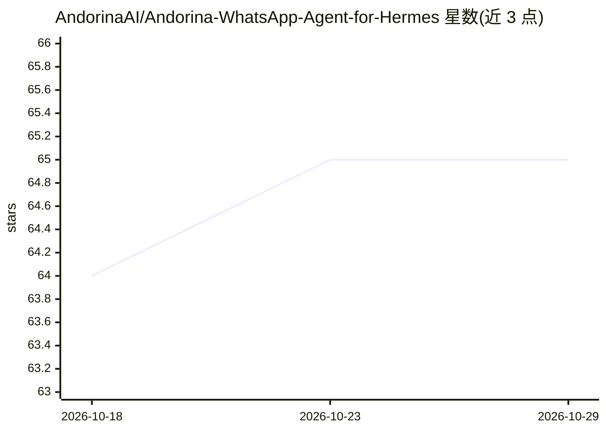

# AndorinaAI/Andorina-WhatsApp-Agent-for-Hermes

⭐ 65 · Python · NOASSERTION · 推送 2026-10-27 · [GitHub](https://github.com/AndorinaAI/Andorina-WhatsApp-Agent-for-Hermes) · [官网](https://andorinaai.github.io/Andorina-WhatsApp-Agent-for-Hermes/) · 组织维护

**把 Hermes Agent 变成 WhatsApp 自主管理器的技能套件**

面向 Hermes Agent（要求 v0.16.0+）的 WhatsApp 自动化管理技能：提供消息发送、定时/循环任务调度、文件与语音笔记发送、Google 联系人 OAuth2 同步与模糊搜索、RAG 知识注入（PDF/TXT）、长期记忆笔记等工具脚本，并附带 GUI 控制面板、RBAC 角色引擎、Zero-Trust 输入/工具校验与 DLP 管道。当前 v1.5.2-Beta5，仅支持 Linux，通过 Andorina-Panel.sh 安装；README 明确禁止用于群发营销，否则可能被 Meta 封号。

## 筛选速览

| 维度 | 判定 | 备注 |
|---|---|---|
| AI 角色 | `ai-ecosystem` | LLM/agent 周边工具 |
| 许可风险 | `none` | NOASSERTION |
| 部署形态 | `None` |  |
| 模型依赖 | — | README 未给出锁定关系 |
| 硬件要求 | — | 无带数字的原话,不猜 |
| 安装摩擦 | `low` | 无编译、无系统依赖或容器化 |
| 成熟度 | `idea` | |

## 能力要点

- 消息/文件/语音笔记发送与定时、crontab 循环任务调度
- Google Contacts OAuth2 同步、模糊搜索与 LID 身份解析
- RBAC 角色引擎 + input_guard/tool_guard 校验 + DLP 管道
- GUI 面板、Live 监控、Cloudflare Tunnel 远程访问、100% 本地处理

## 适用场景

- 用自然语言让 agent 代发消息、定时消息和管理联系人笔记
- 为 WhatsApp 通讯接入 RAG 知识文件与长期记忆
- 通过 Web 面板管理角色权限、插件与多 agent 任务

## 场景标签

`Agent 记忆` `RAG` · 领域:Agent 开发

## 证据(README 行号)

> L92: > **Requires Hermes Agent >= v0.16.0.** Update with `hermes update` before installing. The installer checks this au
> L42:  Turn Hermes into an autonomous WhatsApp manager.

## 星数曲线

2026-10-18 64 → 2026-10-29 65（+1）

---
*卡片 v1 · prompt 1.4 · 生成 2026-10-24 · 置信度 high · 依据 README sha `80b9cfbaa19e` · [字段定义](../../DATASET.md)*
