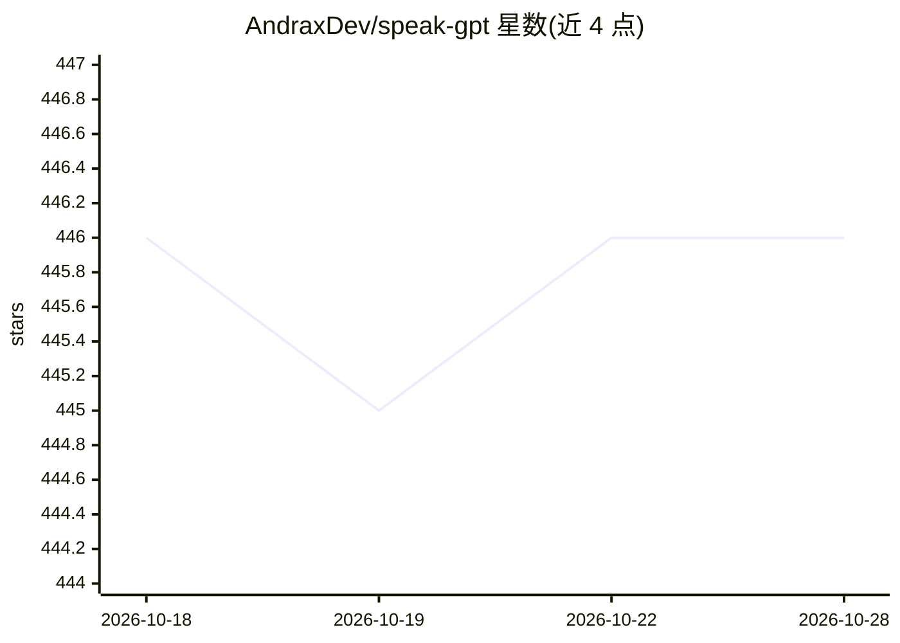

# AndraxDev/speak-gpt

⭐ 447 · Kotlin · Apache-2.0 · 推送 2026-09-15 · [GitHub](https://github.com/AndraxDev/speak-gpt) · [官网](https://play.google.com/store/apps/details?id=org.teslasoft.assistant) · 个人维护

**安卓上的开源语音 AI 助手客户端，接入多厂商 LLM API**

面向终端用户的 Android 语音助手与聊天客户端，通过用户自备的 API key 调用云端大模型：支持 OpenAI（完整）、GROQ/Azure（部分）、OpenRouter（文本生成，可搭配 Gemini、Claude、Llama 等），并可添加自定义 API 端点。功能含聊天、图像生成、图片识别、语音输入（Whisper/Google）、函数调用、提示词库与 Playground；API key 本地存储。通过 Google Play 分发，另有 Web 版；项目为作者学士论文的一部分，要求署名。注意即将停止支持 Android 9/10/11。

## 筛选速览

| 维度 | 判定 | 备注 |
|---|---|---|
| AI 角色 | `ai-native` | 本体是模型或模型工具 |
| 许可风险 | `permissive` | Apache-2.0 |
| 部署形态 | `None` |  |
| 模型依赖 | locked-api |  |
| 硬件要求 | — | 无带数字的原话,不猜 |
| 安装摩擦 | `low` | 无编译、无系统依赖或容器化 |
| 成熟度 | — | 结构信号不足 |

## 能力要点

- 支持 OpenAI/GROQ/Azure/OpenRouter 及自定义 API 提供商
- 图像生成、图片识别、语音输入（Whisper/Google）
- API key 本地存储，不收集个人数据，发布版经 VirusTotal 检查
- 可调温度、topP 等模型参数，支持自定义微调模型

## 适用场景

- 在手机上用自己的 API key 与 GPT 等模型对话
- 通过语音输入使用 AI 助手处理日常问答
- 用手机拍照识别图片并与模型讨论

## 场景标签

`AI 助手` `聊天机器人` `图像生成` · 领域:对话与助手

## 证据(README 行号)

> L3: SpeakGPT is an advanced and highly intuitive open-source AI assistant that utilizes the powerful large language mode
> L38: ## API providers supported
> L40: - OpenAI (Full support)

## 星数曲线

2026-10-18 446 → 2026-10-28 446（+0）

---
*卡片 v1 · prompt 1.4 · 生成 2026-10-21 · 置信度 high · 依据 README sha `1a2c6f805ba7` · [字段定义](../../DATASET.md)*
