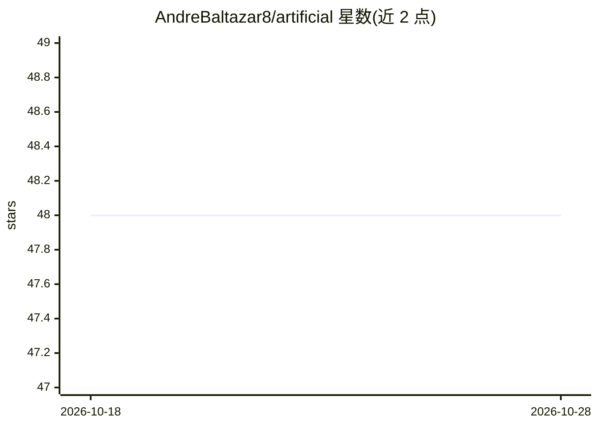

# AndreBaltazar8/artificial

⭐ 48 · Go · MIT · 推送 2026-04-27 · [GitHub](https://github.com/AndreBaltazar8/artificial) · [官网](https://artificial.pt) · 个人维护

**Go 编写的多 AI agent 编排框架：从单一仪表盘管理 AI 团队**

用 Go 构建的开源 AI agent harness，以中央服务（svc-artificial）运行 Web 仪表盘、REST API 与 WebSocket hub，并通过 worker 二进制管理 agent 生命周期。支持将 Claude Code CLI、OpenAI Codex CLI、ACP 服务器（Cursor Agent、opencode 已测试）及本地模型作为后端并行运行；agent 拥有角色人设、技能、频道通信、共享看板任务与 MCP 工具，支持会话持久化。可设置 CEO agent 自主增派 worker。需 Go 1.25+ 从源码构建；本地模型后端标注需较强模型。

## 筛选速览

| 维度 | 判定 | 备注 |
|---|---|---|
| AI 角色 | `ai-ecosystem` | LLM/agent 周边工具 |
| 许可风险 | `permissive` | MIT |
| 部署形态 | `None` |  |
| 模型依赖 | local-ok | 支持本地模型 |
| 硬件要求 | — | 无带数字的原话,不猜 |
| 安装摩擦 | `low` | 无编译、无系统依赖或容器化 |
| 成熟度 | — | 结构信号不足 |

## 能力要点

- 多后端支持：Claude Code、Codex、ACP 服务器、本地模型（OpenAI 兼容 API）
- 实时 Web 仪表盘：聊天、看板任务、Live TTY 终端流
- CEO 角色 agent 可自主雇佣/增派其他 worker
- MCP 工具暴露与会话持久化（中断恢复不丢上下文）

## 适用场景

- 以虚拟团队形式并行运行多个 AI 编码 agent 完成项目
- 通过聊天指派 CEO agent 自主扩充和管理工作团队
- 用统一界面管理本地模型与云端 CLI agent 混合团队

## 场景标签

`多智能体` `Agent 框架` · 领域:Agent 开发

## 证据(README 行号)

> L3: An open source AI agent harness for orchestrating multiple AI workers from a single dashboard. Built in Go.
> L5: Artificial lets you spawn, manage, and coordinate AI agents (Claude Code, OpenAI Codex, ACP-compatible models, local
> L12: - **Multiple backends** — supports Claude Code, OpenAI Codex, ACP (Agent Communication Protocol), and local models 

## 星数曲线

2026-10-18 48 → 2026-10-28 48（+0）

---
*卡片 v1 · prompt 1.4 · 生成 2026-10-25 · 置信度 high · 依据 README sha `5f362391e073` · [字段定义](../../DATASET.md)*
