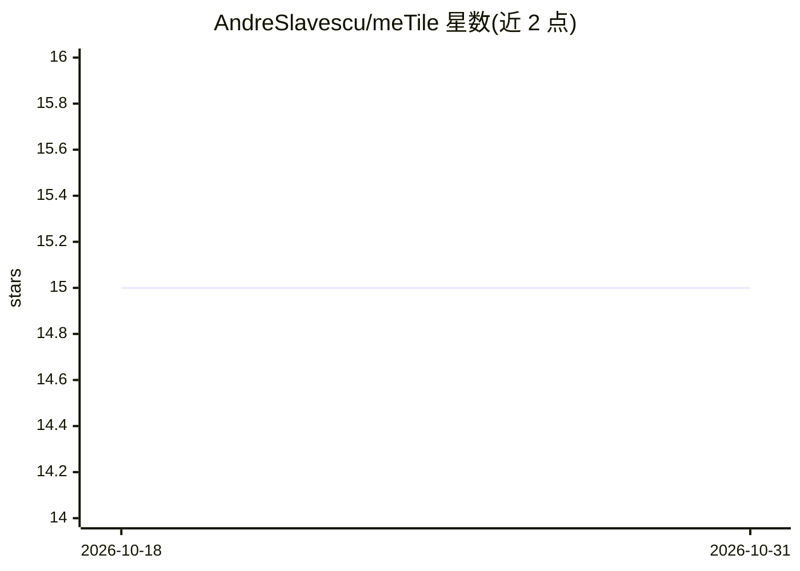

# AndreSlavescu/meTile

⭐ 15 · Python · MIT · 推送 2026-10-05 · [GitHub](https://github.com/AndreSlavescu/meTile) · [官网](https://andreslavescu.github.io/meTile/docs/) · 个人维护

**在 Python 中编写 GPU kernel 并编译为 Metal 的 eDSL**

面向 Apple silicon 的 Python 嵌入式 DSL：用户以 Python 声明张量并编写 GPU kernel，meTile 将其编译为 Metal Shading Language；支持显式指定布局与调度策略，MLX 集成为可选项，编译器本身不依赖 kernels 项目。安装方式为从源码 checkout 后 pip install -e .，需 Apple silicon Mac 与 Python 3.10+。项目自述为实验性，性能随工作负载而异，文档含实测结果与复现命令。灵感来源包括 CuTe、Triton 等。

## 筛选速览

| 维度 | 判定 | 备注 |
|---|---|---|
| AI 角色 | `ai-ecosystem` | LLM/agent 周边工具 |
| 许可风险 | `permissive` | MIT |
| 部署形态 | `library` | 以包/库形式分发 |
| 模型依赖 | — | README 未给出锁定关系 |
| 硬件要求 | — | 无带数字的原话,不猜 |
| 安装摩擦 | `low` | 无编译、无系统依赖或容器化 |
| 成熟度 | `idea` | |

## 能力要点

- Python 编写 GPU kernel 并编译为 Metal
- 支持显式张量布局与调度选择
- MLX 集成可选，编译器不依赖附加 kernels 项目
- MIT 许可，实验性状态（自述）

## 适用场景

- 在 Apple silicon 上用 Python 编写 Metal GPU kernel
- 需要显式控制张量布局与调度的高性能 kernel 开发
- 配合 MLX 生态做 GPU kernel 实验

## 场景标签

 · 领域:编译器/机器学习基础设施

## 证据(README 行号)

> L5:  GPU kernels in Python. Compiled for Apple silicon.
> L7: Write GPU kernels in Python; meTile compiles them to Metal. Declare tensors,
> L8: then choose explicit layouts and schedules where needed. MLX integration is

## 星数曲线

2026-10-18 15 → 2026-10-31 15（+0）

---
*卡片 v1 · prompt 1.4 · 生成 2026-10-31 · 置信度 high · 依据 README sha `7325bc01aff9` · [字段定义](../../DATASET.md)*
