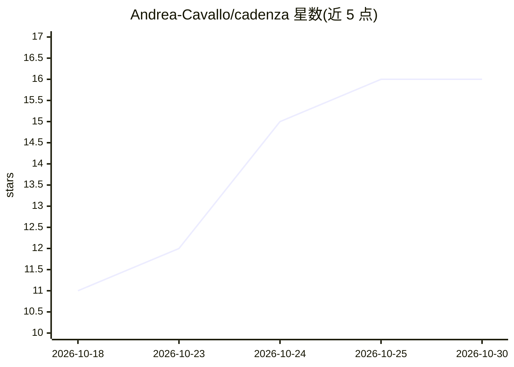

# Andrea-Cavallo/cadenza

⭐ 16 · Go · MIT · 推送 2026-08-03 · [GitHub](https://github.com/Andrea-Cavallo/cadenza) · 个人维护

**面向渐进浩室/旋律 Techno 的 MIDI 生成器，输入 BPM+调性输出多轨 MIDI**

用 Go 编写的 MIDI 生成工具：输入 BPM 与调性，输出和声一致的 MIDI 分轨文件，可直接导入任意 DAW。提供两种模式：LLM 模式（Claude/Ollama/OpenAI/Gemini 生成 bassline、arpeggio、melody 3 轨）与纯算法离线模式（--no-llm，配合 StyleFamily 生成 7 轨，零网络零 API 调用，种子确定性可复现，2 秒内完成）。同一引擎驱动 CLI 与基于 Wails v2 的桌面应用（含钢琴卷帘预览）。构建脚本产出 Windows/macOS/Linux 自包含 zip 分发包。LLM 失败时静默回退到离线引擎。

## 筛选速览

| 维度 | 判定 | 备注 |
|---|---|---|
| AI 角色 | `ai-native` | 本体是模型或模型工具 |
| 许可风险 | `permissive` | MIT |
| 部署形态 | `desktop` | 安装包/桌面程序 |
| 模型依赖 | local-ok | 支持本地模型 |
| 硬件要求 | — | 无带数字的原话,不猜 |
| 安装摩擦 | `low` | 无编译、无系统依赖或容器化 |
| 成熟度 | — | 结构信号不足 |

## 能力要点

- LLM 模式支持 Claude/Ollama/OpenAI/Gemini 生成 3 条和声一致的分轨
- 离线模式纯算法生成 7 轨，种子确定性可复现，零网络与 API 成本
- 确定性渲染器应用力度、门限、CC 自动化等风格化规则
- CLI 与 Wails v2 桌面应用（钢琴卷帘预览、分轨下载）共用同一引擎

## 适用场景

- 在 DAW 中快速生成 progressive house / melodic techno 的编曲草稿
- 无 API key 环境下用离线确定性模式批量生成 7 轨 MIDI
- 用本地 Ollama 模型以隐私优先方式生成音乐动机

## 场景标签

 · 领域:音乐生成/音频工具

## 证据(README 行号)

> L28: Cadenza is a MIDI generator written in Go. Feed it BPM + key; it produces harmonically coherent MIDI stems rendered
> L30: **LLM mode** (Claude, Ollama, OpenAI, Gemini) generates 3 stems — bassline, arpeggio, melody. The LLM creates music
> L32: **Offline mode** (`--no-llm` with StyleFamily `groove` / `rolling` / `sub`) generates 7 stems — bassline-groove, ba

## 星数曲线

2026-10-18 11 → 2026-10-30 16（+5）

---
*卡片 v1 · prompt 1.4 · 生成 2026-10-30 · 置信度 mid · 依据 README sha `d3b4d69c386c` · [字段定义](../../DATASET.md)*
