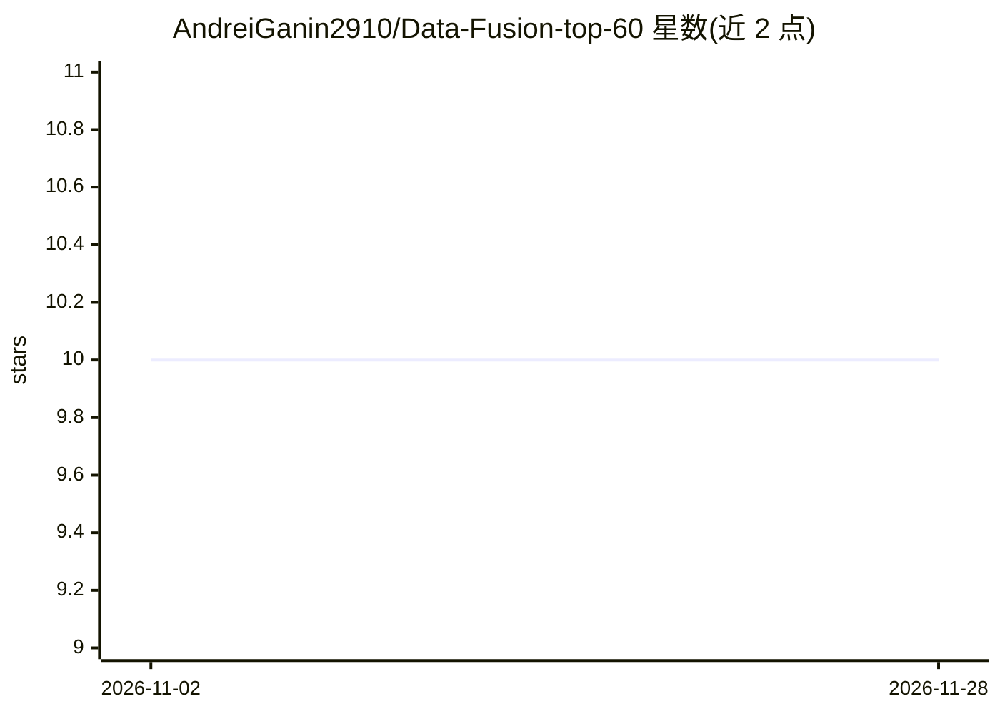

# AndreiGanin2910/Data-Fusion-top-60

⭐ 10 · Python · 推送 2026-04-07 · [GitHub](https://github.com/AndreiGanin2910/Data-Fusion-top-60) · 个人维护

**Data Fusion 2026 竞赛多标签银行产品预测方案（Top-60）**

针对 Data Fusion Contest 2026「Киберполка」任务的竞赛解决方案代码：为 100 万匿名客户预测 41 个银行产品的开通概率（多标签分类）。流程覆盖 per-target 特征筛选、OOF meta 特征、目标编码、特征工程、LightGBM/CatBoost GBDT 训练、MLP 与 DAE+TabM 神经网络，最终通过 rank averaging 四模型混合生成提交文件。要求 Python 3.11+、CUDA GPU、10GB RAM 与 6GB VRAM，训练约 25 小时。

## 筛选速览

| 维度 | 判定 | 备注 |
|---|---|---|
| AI 角色 | `ai-native` | 本体是模型或模型工具 |
| 许可风险 | `none` | — |
| 部署形态 | `library` | 以包/库形式分发 |
| 模型依赖 | — | README 未给出锁定关系 |
| 硬件要求 | — | 无带数字的原话,不猜 |
| 安装摩擦 | `medium` | 含编译或系统依赖之一 |
| 成熟度 | — | 结构信号不足 |

## 能力要点

- 41 目标逐一训练 LightGBM+CatBoost，按 Normal/Rare/Hard 自适应超参
- DAE 预训练提取 192 维嵌入 + TabM Batch Ensemble（k=12 子网络）
- 四模型 OOF blending，Private ROC-AUC 0.845
- mmap/分批/checkpoint 的 RAM-safe 设计

## 适用场景

- 参加 Data Fusion 竞赛同类表格多标签预测任务
- 参考大规模稀疏多标签问题的特征工程与建模流程
- 在有限显存（6GB VRAM）下复现竞赛级表格建模 pipeline

## 场景标签

 · 领域:机器学习/竞赛

## 证据(README 行号)

> L11: **Задача «Киберполка»**: предсказать вероятности открытия каждого из 41 финансового продукта (счета, карты, услуги)

## 星数曲线

2026-11-02 10 → 2026-11-28 10（+0）

---
*卡片 v1 · prompt 1.4 · 生成 2026-11-20 · 置信度 high · 依据 README sha `21c550718672` · [字段定义](../../DATASET.md)*
