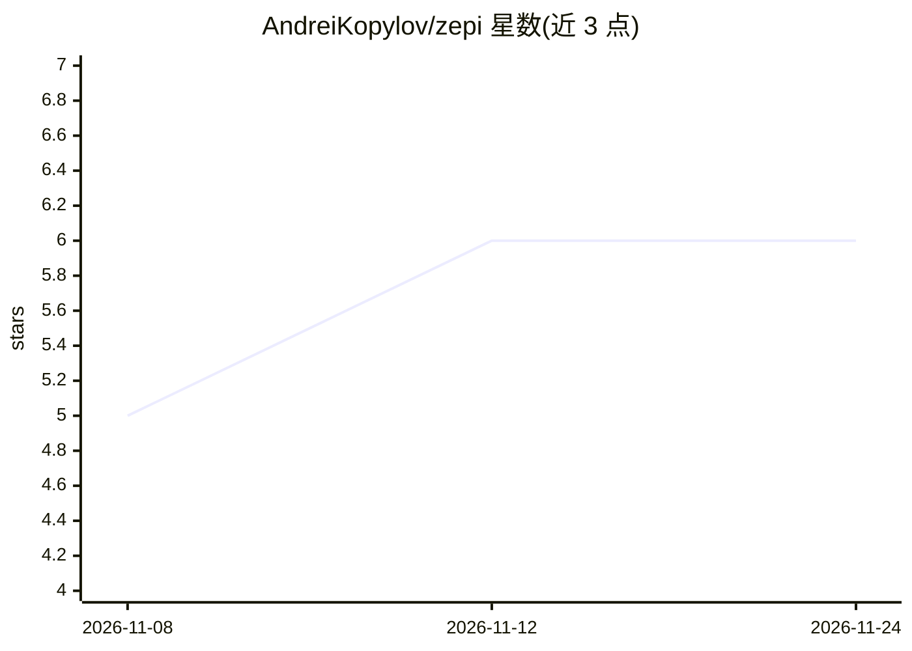

# AndreiKopylov/zepi

⭐ 6 · Rust · GPL-3.0 · 推送 2026-11-22 · [GitHub](https://github.com/AndreiKopylov/zepi) · 个人维护

**Windows 代码与办公文档编辑器，内置 agent**

把 Zed 编辑器与 pi agent 通过 ACP 协议接到一个窗口：代码编辑（LSP、git、终端）与 .pptx/.docx/.xlsx 的查看编辑并存，无需 Microsoft Office；agent 通过捆绑技能与内置 Python 3.13（python-docx/openpyxl/python-pptx）直接处理文档。模型不随构建附带，用户需在设置中自行配置 OpenAI 兼容端点或 pi 内置 provider 与密钥。提供 Windows 安装包，beta 阶段无自动更新、安装包未签名。

## 筛选速览

| 维度 | 判定 | 备注 |
|---|---|---|
| AI 角色 | `ai-enhanced` | 去掉 AI 部分产品仍成立 |
| 许可风险 | `viral` | GPL-3.0 |
| 部署形态 | `desktop` | 安装包/桌面程序 |
| 模型依赖 | — | README 未给出锁定关系 |
| 硬件要求 | — | 无带数字的原话,不猜 |
| 安装摩擦 | `medium` | 含编译或系统依赖之一 |
| 成熟度 | `idea` | |

## 能力要点

- Zed 编辑器 + pi agent 经 ACP 集成，单窗口含代码/终端/git/对话
- 无需 Office 查看编辑 .pptx/.docx/.xlsx，`zepi office render` 可渲染为 PNG
- 捆绑文档处理技能与 Python 3.13 环境，office 文档处理无需额外安装
- 支持 MCP、子 agent、会话命令（/fork、/export、/compact）

## 适用场景

- 在 Windows 上用带 agent 的编辑器写代码并操作终端
- 不安装 Microsoft Office 查看/编辑 pptx、docx、xlsx
- 把幻灯片或文档片段发送给 agent 处理
- 自备模型端点与密钥接入对话式 agent

## 场景标签

`编码 Agent` `AI 助手` · 领域:编码与开发

## 证据(README 行号)

> L5: **A Windows workspace for code and office documents with an agent built in.**
> L7: Zepi wires the Zed editor to the
> L18: |**Agent**|Chat with your provider's models, tools (files, search, PowerShell, codemode), subagents, sessions (`/fo

## 星数曲线

2026-11-08 5 → 2026-11-24 6（+1）

---
*卡片 v1 · prompt 1.4 · 生成 2026-11-20 · 置信度 high · 依据 README sha `4144a63d8b00` · [字段定义](../../DATASET.md)*
